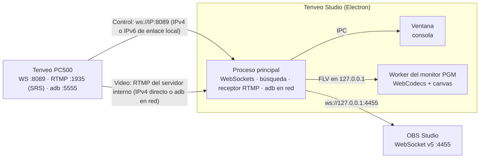

# Tenveo PC500 Studio Link: documentación del proyecto

## 1. ¿Qué es esto?

Es un conjunto de herramientas hechas a medida para **controlar desde la Mac el switcher de video Tenveo PC500** y combinarlo con **OBS Studio**.

El PC500 es un mezclador de video de 4 entradas con un sistema embebido (Linux). Trae su propio panel web (puerto 80), un servidor **WebSocket en el puerto 8089** ("T4 Server") que intercambia mensajes JSON, un servidor **RTMP (SRS 6.0) en el puerto 1935** para sus transmisiones y **adb por red en el puerto 5555**. Analizamos ese panel web (ingeniería inversa) para entender el protocolo, lo confirmamos con un PC500 real, y con eso construimos:

| Componente | Qué hace |
|---|---|
| **App de Electron "Tenveo Studio"** (`tenveo_electron/`) | Consola tipo broadcast: PGM/PVW, CUT/AUTO/FTB, T-Bar, capas (PIP, DSK, LOGO), mezclador, transmisión y grabación del equipo, video en vivo en el monitor PGM y control de OBS. **Todo por la red.** **Es la versión principal.** |
| **Versión web** | La misma consola en el navegador, por la IP del PC500, con un modo demo para probarla sin el equipo |
| **Scripts Python** | Control por línea de comandos y el puente USB de la app anterior |
| **Launcher `start_app.sh`** | Abre la app de Electron, la versión web o la app anterior de Flutter |
| **App de Flutter** (`tenveo_app/`, legado) | Versión anterior. Se conserva como referencia y ya no se desarrolla |
| **Archivos JS/HTML originales** | Copia del panel web del propio PC500, usada como referencia del protocolo |

> **¿Por qué Electron, y por qué la versión 43?** La app de Flutter necesita Xcode para compilarse en macOS, y esta Mac no puede instalarlo. Electron arma la app de Mac sin Xcode y sale para Intel y Apple Silicon a la vez. Se usa **Electron 43** a propósito: esta Mac (iMac Retina 5K de 2014, AMD Radeon R9 M290X, macOS 15 con OpenCore Legacy Patcher) no logra iniciar la GPU con Metal, y Electron 44 quitó el respaldo por OpenGL. Con Electron 44 la app dibujaba todo por software, incluido el video; con Electron 43 usa la GPU. En una Mac moderna las dos funcionan igual (ver sección 8).

---

## 2. Cómo se conecta todo



**Todo va por la red**, sin USB ni modos que elegir:

- **Control:** la app se conecta a `ws://<IP del PC500>:8089`. Si no tiene IP guardada, o si el equipo no responde durante 20 s, lo busca sola en la red (como mucho una vez por minuto). También se puede escribir la IP o usar **Buscar en la red** en los ajustes.
  - **Cable directo PC500 ↔ Mac:** sin router ni DHCP, la Mac y el PC500 no comparten red IPv4 (el PC500 de prueba tiene `192.168.0.177` fija y la Mac queda en `169.254.x.x`). Igual se hablan por **IPv6 de enlace local** (`fe80::…%en0`), que la búsqueda encuentra sola.
- **Video:** la app lo toma del servidor RTMP interno del PC500 (ver 4.4). Si la Mac está en la misma red IPv4, directo; por cable directo, por adb en red.

OBS sigue recibiendo el video del PC500 por su propia captura, como siempre.

---

## 3. Estructura de la carpeta raíz

```
tenveopc500/
├── DOCUMENTACION.md        ← este documento
├── PENDIENTES.md           ← roadmap y pendientes
├── README.md               ← resumen rápido y features
├── start_app.sh            ← launcher: Electron, web o Flutter
├── tenveo_electron/        ← app de Electron (versión principal)
├── tenveo_app/             ← app de Flutter (legado)
├── TenveoStudio.app        ← acceso directo a la app de Flutter (legado)
├── tenveo_bridge.py        ← puente USB de la app de Flutter (legado)
├── tenveo_controller.py    ← control por terminal (CLI)
├── pc.html                 ┐
├── index.js                │ panel web ORIGINAL del PC500
├── util.js                 │ (solo referencia, no se ejecutan)
├── websocketUtil.js        ┘
└── .devcontainer/          ← configuración de GitHub Codespaces
```

### 3.1 Scripts de la raíz

#### [`start_app.sh`](start_app.sh)
- `./start_app.sh` abre la app de Electron. Busca primero `/Applications/Tenveo Studio.app`, después el paquete en `tenveo_electron/dist/` y, si no hay ninguno, la abre desde el código fuente con `npm start` (instala las dependencias la primera vez).
- `./start_app.sh --web` sirve la versión web en `http://localhost:8765` y abre el navegador. Se conecta al PC500 por su IP. Con `Ctrl+C` se detiene.
- `./start_app.sh --flutter` abre la app anterior de Flutter con su puente USB.

#### [`tenveo_bridge.py`](tenveo_bridge.py)
Puente USB de la app anterior de Flutter: cada 5 s revisa `adb devices` y vuelve a aplicar el `adb forward` del 8089. La app de Electron no lo usa.

#### [`tenveo_controller.py`](tenveo_controller.py)
Controla el switcher desde la terminal (requiere `pip install websockets`):

```bash
python3 tenveo_controller.py status      # estado actual
python3 tenveo_controller.py cam 2       # cámara 2 a Preview
python3 tenveo_controller.py cut         # PVW → PGM
python3 tenveo_controller.py auto        # transición automática
python3 tenveo_controller.py ftb         # fade to black
python3 tenveo_controller.py switch 3    # cámara 3 directo al aire
```

#### `pc.html`, `index.js`, `util.js`, `websocketUtil.js`
Son el **panel web que trae el firmware del PC500**, descargado del equipo. Sirvieron para entender el protocolo:
- `websocketUtil.js` abre `ws://<host>:8089`, despacha los mensajes JSON y pinta cada botón con la clase CSS que manda el equipo.
- `index.js` arma la UI y envía `{"<id del control>": valor}`. Todos los botones de la página principal (`#layout_window`) se envían con el mismo código, `{"<id>": 1}`: cámaras, CUT, AUTO, FTB, STREAM, REC, PIP, DSK, LOGO, FREEZE y los demás.
- Las claves del protocolo son los `id` de los controles de `pc.html`: `pvw-1` … `pvw-aux`, `cut`, `auto`, `ftb`, `putter`, `audio_*_vol`, `audio_*_on`, `audio_in*_mode`, `stream`, `stream-1-server`, `rec`, `trans-effect`, `ndi_list`, `sys_ip`, etc.
- La transmisión tiene **un solo botón, STREAM** (`stream`), y **dos destinos** (`stream-1-*` y `stream-2-*`). El botón STREAM 2 (`stream_2`) está siempre desactivado en `pc.html`, y los dos botones "iniciar" de la pestaña de sistema mandan `{"stream": 1}`.
- La opción **Default** de un destino arma `rtmp://<IP del PC500>:1935/live/`: el servidor interno del propio equipo.

---

## 4. La app de Electron (`tenveo_electron/`)

### 4.1 Arquitectura

```
tenveo_electron/
├── package.json                    ← dependencias, scripts y configuración del empaquetado
├── src/
│   ├── core/                       ← lógica compartida (Electron, navegador y pruebas)
│   │   ├── pc500-protocol.js       ← claves del protocolo, lectura de estado y comandos
│   │   ├── tenveo-service.js       ← WebSocket al PC500 por red: latido, latencia y reconexión
│   │   ├── obs-service.js          ← cliente OBS WebSocket v5 con contraseña
│   │   ├── obs-auth.js             ← cálculo de la contraseña de OBS (SHA-256)
│   │   ├── studio-controller.js    ← comandos, SYNC OBS y configuración
│   │   ├── simulators.js           ← simuladores del PC500 y de OBS (pruebas y modo demo)
│   │   ├── simulated-websocket.js  ← WebSocket falso para el modo demo
│   │   └── emitter.js              ← suscriptores de cambios
│   ├── main/                       ← proceso principal de Electron
│   │   ├── main.js                 ← ventana, protocolo app://, IPC, búsqueda automática y arranque
│   │   ├── adb-bridge.js           ← video por adb en red: conecta, reenvía el RTMP y limpia al salir
│   │   ├── lan-discovery.js        ← busca el PC500 en la red local (IPv4 e IPv6 de enlace local)
│   │   ├── net-websocket.js        ← WebSocket sin compresión que acepta IPv6 con zona (fe80::…%en0)
│   │   ├── video-receiver.js       ← lee el RTMP del PC500 y lo entrega como FLV local
│   │   ├── settings-store.js       ← configuración; contraseña de OBS cifrada en el llavero
│   │   └── vendor/node-media-server/ ← piezas del protocolo RTMP (Apache 2.0)
│   ├── preload/preload.cjs         ← puente seguro entre la ventana y el proceso principal
│   └── renderer/                   ← la consola: HTML, CSS y JavaScript sin frameworks
│       ├── index.html
│       ├── styles/app.css          ← tema oscuro minimalista
│       └── js/
│           ├── app.js              ← dibuja el estado y manda comandos
│           ├── video.js            ← arranca el monitor PGM y muestra sus avisos
│           ├── pgm-worker.js       ← monitor PGM: decodifica con WebCodecs y dibuja en un canvas
│           ├── backend.js          ← elige Electron o navegador
│           └── local-backend.js    ← modo navegador y modo demo
├── dev/                            ← simuladores por WebSocket, emisor de video y capturas (solo pruebas)
├── scripts/                        ← start, web, mock, smoke, check-device, bench-network, bench-video y prepare-adb
└── test/                           ← pruebas automáticas (node --test)
```

Patrón: **Servicios** (I/O de red) → **Controlador** (estado y lógica) → **Ventana** (dibujo). En Electron, servicios y controlador corren en el proceso principal y la ventana recibe el estado por IPC. En el navegador corren dentro de la página. La única dependencia en tiempo de ejecución es `ws`; `electron`, `electron-builder` y `node-media-server` son de desarrollo, y de este último solo se copian las piezas del protocolo RTMP, con su licencia.

Seguridad:
- La ventana corre con `contextIsolation` y `sandbox`, sin acceso a Node. Solo ve cuatro funciones del preload.
- La interfaz se sirve con el protocolo propio `app://tenveo`, que solo expone `renderer/` y `core/`.
- El proceso principal acepta solo comandos conocidos y solo de la ventana de la app.
- La app no pide cámara, micrófono ni otros permisos del sistema: los rechaza todos.
- El video se entrega solo en 127.0.0.1.
- La app nunca cambia los destinos de transmisión del PC500 y nunca enciende o apaga STREAM si un destino sale a internet (ver 4.4).
- La página tiene una Content-Security-Policy estricta (solo permite el worker propio), y los nombres de escenas de OBS se insertan como texto.

### 4.2 Protocolo del PC500 ([`pc500-protocol.js`](tenveo_electron/src/core/pc500-protocol.js))

| Acción | Mensaje enviado | Control del panel original |
|---|---|---|
| Cámara a Preview | `{"pvw-3": 1}` | botones `pvw-1` … `pvw-aux` |
| CUT, AUTO, FTB | `{"cut": 1}`, `{"auto": 1}`, `{"ftb": 1}` | botones `cut`, `auto`, `ftb` |
| Cámara directo al aire | `pvw-N` y, 150 ms después, `cut` | combinación de los dos |
| T-Bar | `{"putter": 0…255}` mientras se arrastra | slider `putter` |
| Capas y equipo | `{"pip1-on-air": 1}`, `{"dsk": 1}`, `{"stream": 1}`, `{"rec": 1}`… | botones de la página principal |
| Volumen | `{"audio_in1_vol": -12}`, en dB de -60 a 0 | sliders `audio_*_vol` |
| Silencio de PGM y MIC 1 | `{"audio_pgm_on": 0}` (1 encendido, 0 apagado) | casillas `audio_*_on` |
| Silencio de IN 1 a IN 4 | `{"audio_in1_mode": 0}` (0 OFF, 1 ON, 2 AFV) | modos `audio_in*_mode` |

Lectura de estado, igual que `websocketUtil.js`:
- `pvw-N: "active-red"` → cámara N en **PGM**; `"active-green"` → en **PVW**. Si el equipo no informa ninguna cámara encendida (pasa tras un reinicio), la app muestra "sin dato" en vez de inventar una, y SYNC OBS no toca la escena.
- Cada botón del panel, CUT, AUTO y FTB guardan su luz: solo cuentan `active-*` y `flash-*` con su color.
- **El PC500 guarda los comandos crudos que recibe** y se los manda a quien se conecta (por ejemplo `"cut": 1` o `"pvw-aux": 1`). Un `1` no es una luz, y tapa la luz verdadera hasta que el equipo la vuelve a informar. Por eso la app no manda una cámara a Preview si ya está en Preview. Lo guardado desapareció cuando el equipo se reinició.
- STREAM: `"stream": "active-green"` transmitiendo, `"none-green"` apagado; `stream_time` cuenta segundos mientras transmite.
- `stream-1-server`, `stream-1-key`, `stream-2-server` y `stream-2-key` → los dos destinos de STREAM. La app solo los lee.
- `audio_<canal>_vol`, `audio_<canal>_on` y `audio_in<N>_mode` → volumen y estado de cada canal.
- `sys_ip`, `system_version`, `stream_time` y `record_time` → IP, firmware y tiempos de transmisión y grabación.

### 4.3 Comunicación por red ([`tenveo-service.js`](tenveo_electron/src/core/tenveo-service.js))
- **Una sola ruta:** `ws://<IP>:8089`, con IPv4 o IPv6 de enlace local. Como las URL estándar no admiten la zona (`%en0`), [`net-websocket.js`](tenveo_electron/src/main/net-websocket.js) abre el socket a mano.
- **Baja latencia:** la conexión usa la librería `ws`, sin compresión y con `TCP_NODELAY`. El PC500 tampoco negocia compresión.
- **Latido y latencia:** manda un ping cada segundo y muestra la latencia de ida y vuelta en la barra superior. Si el equipo ya respondió algún ping y deja de responder 4 s, la app corta y reconecta sola. Un equipo que no contesta pings nunca pierde la conexión por esto. El PC500 real contesta en 1 a 2 ms.
- **Reconexión:** si la conexión se cae, reintenta de inmediato y después a los 250 ms, 500 ms, 1 s y luego cada 2 s, sin olvidar la IP. Un cambio de IP mientras conecta termina siempre en la IP nueva.
- **Respuesta inmediata:** al elegir una cámara en Preview, la tecla se marca en el mismo cuadro del clic y el equipo lo confirma unos ms después. Lo que sale al aire (CUT, AUTO, la T-Bar) siempre se muestra como lo informa el equipo.
- **Envío continuo:** la ventana manda la T-Bar y los faders como mucho una vez por cuadro de pantalla. Si además el sistema operativo deja de aceptar datos, el servicio guarda solo el último valor por control. Un botón como CUT saca primero lo pendiente, así el orden se respeta.
- **Búsqueda en la red** ([`lan-discovery.js`](tenveo_electron/src/main/lan-discovery.js)): recorre la subred IPv4 de cada interfaz de la Mac con 64 conexiones a la vez y, además, manda un ping IPv6 a `ff02::1` por cada interfaz para encontrar equipos por cable directo. Prueba el puerto 8089, confirma que el primer mensaje sea del PC500 y, si encuentra el mismo equipo por las dos vías, prefiere la IPv4. Tarda unos segundos.

### 4.4 Video en el monitor PGM ([`video-receiver.js`](tenveo_electron/src/main/video-receiver.js), [`pgm-worker.js`](tenveo_electron/src/renderer/js/pgm-worker.js))

**Cómo transmite el PC500** (confirmado con el equipo real): con **STREAM** encendido, el PC500 transmite **a sus dos destinos a la vez**. Si un destino está en **Default** (`rtmp://<IP del PC500>:1935/live/`), el video queda en su servidor interno (SRS 6.0). Llega en H.264 1920×1080 a 60 cuadros, con audio AAC estéreo de 48 kHz y unos 11,6 Mbit/s con cámaras conectadas. La primera imagen aparece unos 0,8 s después de encender STREAM. Ese servidor escucha **solo por IPv4** y **manda el video a ráfagas cada ~350 ms** (su ajuste `mw_latency` de fábrica).

Hay **un solo modo**: la app toma el video del servidor interno del PC500. Lee el destino que está en Default (prefiere el destino 2, así el 1 queda para YouTube u otra plataforma) y lo muestra en cuanto STREAM está encendido. **Encender STREAM** y **Apagar STREAM** lo controlan desde la pestaña Equipo. No cambia nada en el equipo.

**Cómo llega la app al servidor interno**, que solo escucha por IPv4:
1. Por **red IPv4**, si la Mac está en la misma red que el PC500.
2. Por **cable directo** (sin IPv4 en común): la app se conecta por **adb en red** a `[fe80::…%en0]:5555`, reenvía solo el RTMP y lo lee por `127.0.0.1:19350`. Al cerrar, quita el reenvío y se desconecta. Si el cable o el PC500 se reiniciaron y adb quedó con la ruta vieja ("No route to host"), reinicia su servidor y vuelve a probar. Cada comando de adb tiene un límite de tiempo que se cumple aunque el proceso no termine: en esta Mac se vio adb quedar trabado dentro del sistema (procesos en estado `UE` que ni `kill -9` cierra).

> **Lo más estable por cable directo:** poner en el Ethernet de la Mac una IP manual de la red del PC500 (por ejemplo `192.168.0.50`, máscara `255.255.255.0`, en *Ajustes del Sistema → Red → Ethernet → Detalles → TCP/IP*). Así el video llega directo por IPv4, sin adb. El control sigue igual. La app muestra la IP exacta cuando hace falta.

**El monitor PGM:**
- El proceso principal pasa el video sin recodificar a FLV y lo entrega en `127.0.0.1`, con la cabecera y el último GOP guardados para que la imagen aparezca al instante.
- Un **worker** lo lee, lo decodifica con **WebCodecs** (por la GPU) y lo dibuja en un canvas transferido (OffscreenCanvas). Así ni el trabajo de la interfaz frena el video ni el video frena la interfaz. No hay MSE ni búferes de segundos.
- Los cuadros esperan solo lo necesario para absorber la llegada irregular de la red: el worker mide cuándo llega cada cuadro respecto de su marca de tiempo, y la espera cubre la dispersión de los últimos 2 s. Por una red pareja queda en unos pocos milisegundos. Con el SRS del PC500, que manda a ráfagas, queda en ~350 ms para que la imagen no salte.
- Al conectar llega de golpe el GOP guardado: esos cuadros se decodifican pero no se dibujan, y la imagen salta directo al vivo.
- Si el decodificador falla (pasó una vez con el equipo real, con el error genérico "Decoder error"), el monitor se rearma solo en el siguiente cuadro clave con la última configuración; si falla dos veces, pasa a decodificar por software.
- Si STREAM se apaga, el servidor del PC500 mantiene la conexión: la app lo detecta por el aviso del servidor o por 3 s sin paquetes, muestra "STREAM apagado" y retoma sola cuando vuelve. La línea de estado muestra la resolución y los cuadros por segundo que informa el equipo.

**Reglas de seguridad:**
- La app **nunca cambia los destinos** de transmisión del PC500.
- **Encender STREAM** solo se activa si ningún destino sale a internet: con STREAM el equipo transmite a los dos destinos, y si uno es YouTube saldría al aire. En ese caso el video aparece cuando el usuario sale al aire por su cuenta.
- **Apagar STREAM** solo se activa si ningún destino sale a internet, para no cortar una transmisión en vivo.

### 4.5 OBS ([`obs-service.js`](tenveo_electron/src/core/obs-service.js))
Cliente del protocolo **OBS WebSocket v5** (por defecto `ws://127.0.0.1:4455`):
- Saludo: Hello (op 0) → Identify (op 1) → Identified (op 2).
- **Contraseña:** si OBS la pide, el Identify lleva `base64(sha256(base64(sha256(contraseña + salt)) + challenge))`. Si no coincide, OBS cierra con el código 4009 y la app lo avisa.
- Pide `GetStreamStatus`, `GetRecordStatus`, `GetVirtualCamStatus` y `GetSceneList`, y escucha sus cambios.
- Acciones: `ToggleStream`, `ToggleRecord`, `ToggleVirtualCam`, `SetCurrentProgramScene`.
- Con **SYNC OBS**, cuando cambia la cámara en PGM, la app pone al aire la escena de OBS cuyo nombre contenga `cam N`, `camN` o `camera N`. Nombra tus escenas `Cam 1`, `Cam 2`, `Cam 3`, `Cam 4`.

### 4.6 Video por adb en red ([`adb-bridge.js`](tenveo_electron/src/main/adb-bridge.js))
- Busca `adb` en este orden: copia incluida en la app, `vendor/`, `ANDROID_HOME` o `ANDROID_SDK_ROOT`, rutas comunes, el `PATH` y el shell de inicio del usuario.
- Solo se usa cuando la app controla el PC500 por la red y la Mac no comparte su red IPv4 (cable directo). Entonces se conecta a `<dirección>:5555` y reenvía el 19350 → 1935. Revisa cada 3 s; si falla, espera unas vueltas antes de reintentar.
- Si adb no responde (en esta Mac llegó a quedar trabado dentro del sistema hasta reiniciarla), el puente espera cada vez más entre intentos (30 s, 1 min, 2 min… hasta 5 min) para no ir dejando procesos colgados, y la línea de estado pide poner en la Mac una IP de la red del PC500.
- Al cerrar la app quita el reenvío y desconecta el adb por red si lo conectó ella.

### 4.7 Interfaz
- Barra superior: estado del PC500 con su latencia, estado de OBS, salidas de OBS (Live, Rec, Vcam), SYNC OBS y ajustes.
- Monitores: el PGM, con el video en vivo del PC500, ocupa dos tercios en 16:9; el PVW, que no lleva video, es una tarjeta de la misma altura con la cámara en Preview. Los monitores se dimensionan por su ancho y la consola se queda con el resto de la altura, así no quedan franjas vacías.
- Consola: buses Program y Preview y capas en dos filas como en el equipo, en una grilla de 7 columnas compartida (las teclas llenan el ancho y quedan alineadas), CUT y AUTO juntos arriba, FTB aparte abajo (para no pulsarlo sin querer) y una T-Bar que usa toda la altura de la consola.
- Sin conexión con el PC500, la consola, el mezclador y los botones del equipo quedan atenuados.
- Los avisos aparecen arriba, sobre los monitores, sin tapar controles.
- Barra lateral con pestañas: **Audio** (mezclador), **OBS** (escenas) y **Equipo** (datos del PC500, STREAM, REC y demás botones del equipo, y estado del video con Encender y Apagar STREAM).
- Ajustes: IP del PC500 con **Buscar en la red**, panel web del equipo, **Reconectar** y OBS.
- Cada actualización solo toca el DOM donde algo cambió, y sobre el video no hay efectos de desenfoque (se recalcularían en cada cuadro).
- Atajos: las teclas 1 a 5 ponen la cámara en Preview. CUT y AUTO no tienen atajo a propósito, para que una tecla pulsada por error no cambie lo que está al aire.

### 4.8 Configuración
Se guarda en `~/Library/Application Support/Tenveo Studio/settings.json`: IP del PC500, dirección y puerto de OBS, y SYNC OBS. La contraseña de OBS se cifra con el llavero de macOS (`safeStorage`). Las opciones de versiones anteriores (modos USB, fuentes de video) se descartan al leer. En el navegador la configuración queda en el propio navegador y la contraseña solo dura la sesión.

### 4.9 Versión web y modo demo
- `npm run web` sirve la consola en `http://localhost:8765`, que se conecta al PC500 por su IP. El video del PC500 y la búsqueda en la red solo están en la app de escritorio.
- Agregando `?demo` a la dirección, la consola usa simuladores del PC500 y de OBS dentro de la página, sin red. Sirve para probarla desde cualquier dispositivo o un Codespace.

### 4.10 Pruebas
```bash
cd tenveo_electron
npm test             # 91 pruebas: protocolo, red, IPv6, OBS, búsqueda, video, adb, configuración y sintaxis
npm run smoke        # abre la app contra simuladores, pulsa botones y guarda una captura
npm run smoke:web    # lo mismo en modo navegador (SMOKE_WEB_DEMO=1 para el modo demo)
npm run smoke:video  # la app enciende STREAM, toma el video de un servidor RTMP de prueba, lo dibuja y lo apaga
npm run mock         # simuladores del PC500 y de OBS para trabajar sin el equipo
node scripts/screenshots.mjs [carpeta] [--solo 1,7]   # capturas de cada pestaña, ajustes, sin conexión, tamaño mínimo, 1920×1080 y pantalla 5K

# Mediciones (abren la ventana de la app unos segundos):
node scripts/bench-video.mjs                         # video 1080p60: latencia, cuadros perdidos, tirones, clic y CPU
node scripts/bench-video.mjs --app "/ruta/Tenveo Studio.app"   # lo mismo con una app empaquetada
node scripts/bench-network.mjs [--equipo fe80::…%en0]          # red de la versión 1.0.0 contra la actual

# Con el PC500 real (solo lectura, salvo lo indicado):
npm run check-device -- fe80::…%en0                      # conexión, latencia y estado
npm run check-device -- fe80::…%en0 --prueba-preview 5   # cambia el Preview y lo devuelve (no sale al aire)
npm run check-device -- fe80::…%en0 --prueba-video 10 --rtmp 127.0.0.1:19350   # video y cómo llega
node scripts/bench-video.mjs --equipo fe80::…%en0        # fluidez con el video real (enciende y apaga STREAM)
```
El emisor de prueba codifica una carta de ajuste en H.264 con el codificador de Chromium, con la hora estampada en cada cuadro para medir la latencia de punta a punta, y la publica por RTMP como el PC500. El simulador del PC500 imita al equipo real (STREAM verde, destinos en su servidor interno), pero no es el firmware real. Las pruebas que encienden STREAM lo hacen solo si los dos destinos son el servidor interno, y lo apagan al terminar.

### 4.11 Builds disponibles

| Target | Cómo se genera | Resultado |
|---|---|---|
| **Mac universal** (Intel y Apple Silicon) | `npm run dist` | `dist/TenveoStudio-1.3.0-universal.dmg`, `.zip` y `dist/mac-universal/Tenveo Studio.app` |
| Solo Intel o solo Apple Silicon | `npm run dist:x64` o `npm run dist:arm64` | `.dmg` y `.zip` en `dist/` |
| **Web** | no se compila | `npm run web` o `./start_app.sh --web` |

No necesita Xcode. `npm run dist` copia el `adb` de la Mac dentro de la app (`scripts/prepare-adb.mjs`) junto con su aviso de licencia. **No subas Electron a la versión 44** sin probar antes la GPU en esta Mac (sección 8). La app lleva una firma provisional: en otra Mac hay que desbloquearla una vez con:

```bash
xattr -dr com.apple.quarantine "/Applications/Tenveo Studio.app"
```

---

## 5. Puertos usados

| Puerto | Dónde | Uso |
|---|---|---|
| `8089` | PC500 | WebSocket de control (JSON), por red (IPv4 o IPv6) |
| `80` | PC500 | Panel web original (el navegador no lo abre por IPv6 de enlace local) |
| `1935` | PC500 | Servidor RTMP interno (SRS), solo IPv4 |
| `5555` | PC500 | adb por red, para el video por cable directo |
| `1935` → `19350` | PC500 → `localhost` vía adb | Video del servidor interno por cable directo |
| `22` | PC500 | SSH del equipo (la app no lo usa) |
| aleatorio | Mac, solo `127.0.0.1` | Video FLV entre el proceso principal y el monitor PGM |
| `8765` | Mac | Versión web (`npm run web` o `start_app.sh --web`) |
| `4455` | Mac | OBS WebSocket v5 |
| `18089`, `14455` | Mac | Simuladores del PC500 y de OBS (`npm run mock`) |

---

## 6. Uso rápido

1. Conecta el PC500 por **Ethernet** a la misma red que la Mac, o con un **cable de red directo** a la Mac.
2. Abre **OBS** y activa *Herramientas → Configuración del servidor WebSocket* (puerto 4455). Si le pones contraseña, escríbela en los ajustes de la app.
3. Abre **Tenveo Studio**: doble clic en la app o `./start_app.sh`. La app busca sola el PC500 en la red.
4. La barra superior debe decir **PC500 · Red** o **Red · directo** en verde, con la latencia, y **OBS · Conectado**.
5. El video del PC500 aparece en el monitor PGM en cuanto STREAM está encendido. Para verlo sin salir al aire, en **Equipo** pulsa **Encender STREAM** (solo se activa si los destinos de STREAM son el servidor interno del equipo).

macOS pide permiso de **red local** la primera vez, para conectarse al PC500 y buscarlo. Acéptalo.

---

## 7. Probado con el PC500 real

Con el PC500 conectado por **cable directo** a la Mac, del 17 al 18 de octubre de 2026:

| Qué | Resultado |
|---|---|
| Encontrarlo | **Buscar en la red** lo encuentra por IPv6 de enlace local (`fe80::10bf:b2ff:feee:6e2d%en0`) |
| Conexión de control | 6 a 23 ms hasta tener el estado completo; ping de 1 a 2 ms |
| Lectura de estado | PGM, PVW, volúmenes, modos de audio, IP, firmware, STREAM y sus destinos, igual que el panel original |
| Cambiar el Preview | 10 ms de mediana y 16 ms de p90 desde el comando hasta la confirmación del equipo |
| STREAM | Enciende y apaga al instante; `stream_time` corre mientras transmite |
| Video en el monitor PGM (1.3.0) | La app sola: adb por red, Encender STREAM, video de cámara 1920×1080 a 60 cuadros (11,6 Mbit/s), Apagar STREAM y limpieza al salir. 0 cuadros perdidos, ventana a 60 cuadros/s sin tirones, 41 % de CPU |
| Cómo llega el video | El SRS del equipo lo manda a ráfagas: 18 pausas de ~350 ms en 8 s |

Para no afectar lo que estaba al aire, **no se probaron con el equipo** CUT, AUTO, FTB, la T-Bar, los volúmenes ni el silencio (siguen probados con el simulador).

## 8. Mediciones: antes y después

**Video y fluidez** (`node scripts/bench-video.mjs`, ventana visible, video 1080p60):

| Prueba | 1.2.0 (Electron 44) | 1.3.0 |
|---|---|---|
| PC500 real: cuadros perdidos | 36,1 % | **0 %** |
| PC500 real: ventana | 54 cuadros/s, 10,3 % de tirones | **60 cuadros/s, 0 %** |
| PC500 real: búfer del video | 0,65 s | **0,35 s** (las ráfagas del SRS) |
| PC500 real: CPU | 149 % | **41 %** |
| Simulador: latencia de punta a punta (mediana / p95) | 625 / 907 ms | **118 / 149 ms** |
| Simulador: cuadros perdidos | 29,9 % | **0 %** |
| Simulador: clic → Preview pintado | 58 ms | **33 ms** (el cuadro siguiente) |

Las causas, de mayor a menor peso:
1. **La GPU.** En esta Mac, Electron 44 no logra usar la GPU y dibujaba todo por software, incluido el video en una pantalla 5K. Con Electron 43 la app usa la GPU (composición, rasterizado y decodificación de video).
2. **El reproductor.** mpegts.js mantenía entre 0,25 y 1,2 s de búfer. El monitor nuevo con WebCodecs espera solo lo que la red exige.
3. **La interfaz.** Escribía todo el DOM en cada actualización y tenía un desenfoque sobre el video; ahora solo toca lo que cambió.

**Red** (`node scripts/bench-network.mjs --equipo fe80::…%en0`, versión 1.0.0 contra la actual):

| Prueba | 1.0.0 | Actual |
|---|---|---|
| Conexión hasta tener el estado (simulador, mediana) | 2,1 ms | 1,3 ms |
| Mando → confirmación (simulador, mediana / p99) | 0,17 ms / 1,3 a 2,7 ms | 0,15 ms / 0,4 a 0,8 ms |
| Cable cortado sin aviso: se da cuenta | no se entera (más de 20 s) | 3,5 s |
| Cable cortado sin aviso: vuelve a estar conectada | no vuelve | 3,5 s |
| Equipo reiniciado: reconecta tras volver (mediana / peor caso) | 2,8 s / 3,5 s | 0,96 s / 1,36 s |
| PC500 real por cable directo | no conecta ("IP no válida") | conecta en 6 ms |
| PC500 real: mando → confirmación | 10 ms (por un proxy local) | 10 ms |

El mando tarda lo mismo en todas las versiones: esos 10 ms los pone el propio PC500.

## 9. Limitaciones conocidas y pendientes

> [!WARNING]
> CUT, AUTO, FTB, la T-Bar (`putter`), los volúmenes y el silencio se envían con el mismo código que el panel original, pero todavía no se probaron con el equipo (ver sección 7). Si algo no responde, se ajusta en `pc500-protocol.js`.

- **Latencia del video con el PC500:** el SRS del equipo manda el video a ráfagas cada ~350 ms, así que el monitor espera eso para no saltar. Se puede bajar configurando el SRS del PC500 con `min_latency on` (o `mw_latency 0`). Eso exige entrar al sistema del equipo con `adb shell`, que el control de permisos de Claude Code bloqueó; queda pendiente de que el usuario lo autorice (ver PENDIENTES.md).
- **Panel original por cable directo:** el navegador no abre direcciones IPv6 de enlace local. Con cable directo, el botón del panel original pide poner en la Mac una IP de la red del PC500.
- **GPU en esta Mac:** con Electron 44 o posterior la app vuelve a dibujar por software (ver 4.11).
- **Firma de la app:** es provisional. Para repartirla sin avisos de seguridad hace falta una cuenta de desarrollador de Apple y notarización.
- **Vúmetros:** siguen la posición del fader. El PC500 no manda niveles de audio.
- **NDI:** el firmware tiene las claves `ndi_name` y `ndi_list`, pero la app todavía no las controla.
- **Icono:** la app usa el icono por defecto de Electron.
- **App de Flutter (legado):** `tenveo_app/` ya no se desarrolla. Su compilación nativa necesita Xcode y su T-Bar puede mandar varios CUT en un solo arrastre.
