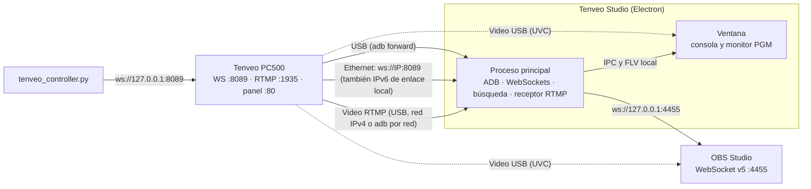

# Tenveo PC500 Studio Link: documentación del proyecto

## 1. ¿Qué es esto?

Es un conjunto de herramientas hechas a medida para **controlar desde la Mac el switcher de video Tenveo PC500** y combinarlo con **OBS Studio**.

El PC500 es un mezclador de video de 4 entradas con un sistema embebido (Linux) que se ve por USB como un dispositivo ADB. Trae su propio panel web (puerto 80), un servidor **WebSocket en el puerto 8089** ("T4 Server") que intercambia mensajes JSON, un servidor **RTMP (SRS 6.0) en el puerto 1935** para sus transmisiones y **adb por red en el puerto 5555**. Analizamos ese panel web (ingeniería inversa) para entender el protocolo, lo confirmamos con un PC500 real, y con eso construimos:

| Componente | Qué hace |
|---|---|
| **App de Electron "Tenveo Studio"** (`tenveo_electron/`) | Consola tipo broadcast: PGM/PVW, CUT/AUTO/FTB, T-Bar, capas (PIP, DSK, LOGO), mezclador, transmisión y grabación del equipo, video en vivo en el monitor PGM y control de OBS. Maneja el puente USB y la red por sí sola. **Es la versión principal.** |
| **Versión web** | La misma consola en el navegador, con un modo demo para probarla sin el equipo |
| **Scripts Python** | Control por línea de comandos y puente USB para la versión web |
| **Launcher `start_app.sh`** | Abre la app de Electron, la versión web o la app anterior de Flutter |
| **App de Flutter** (`tenveo_app/`, legado) | Versión anterior. Se conserva como referencia y ya no se desarrolla |
| **Archivos JS/HTML originales** | Copia del panel web del propio PC500, usada como referencia del protocolo |

> **¿Por qué Electron?** La app de Flutter necesita Xcode para compilarse en macOS, y esta Mac no puede instalarlo. Electron arma la app de Mac sin Xcode, sale para Intel y Apple Silicon a la vez y puede ejecutar `adb` y abrir conexiones de red por sí misma.

---

## 2. Cómo se conecta todo



Hay **dos rutas de control**:

1. **USB:** la app detecta el PC500 con `adb devices` y crea los reenvíos `tcp:8089 → tcp:8089` (WebSocket), `tcp:8080 → tcp:80` (panel web original) y `tcp:19350 → tcp:1935` (video). No hay que configurar IP ni correr scripts. Al cerrar la app, quita los reenvíos.
2. **Red (Ethernet):** la app se conecta a `ws://<IP>:8089`. La IP se escribe en el diálogo de conexión, se encuentra con **Buscar en la red**, o la app la aprende sola cuando el equipo está conectado por USB.
   - **Cable directo PC500 ↔ Mac:** sin router ni DHCP, la Mac y el PC500 no comparten red IPv4 (el PC500 de prueba tiene `192.168.0.177` fija y la Mac queda en `169.254.x.x`). Igual se hablan por **IPv6 de enlace local** (`fe80::…%en0`), que la app encuentra sola con **Buscar en la red** y usa para el control.

El modo **Automático** usa USB si está conectado y, si no, la red. También se puede fijar **Solo USB** o **Solo red**.

El **video** llega por defecto desde el servidor RTMP interno del PC500 (ver 4.4). También puede llegar por USB como cámara UVC, o no usarse. OBS sigue recibiendo el video por USB como siempre.

---

## 3. Estructura de la carpeta raíz

```
tenveopc500/
├── DOCUMENTACION.md        ← este documento
├── PENDIENTES.md           ← roadmap y pendientes
├── README.md               ← resumen rápido y features
├── start_app.sh            ← launcher: Electron, web o Flutter
├── tenveo_electron/        ← app de Electron (versión principal)
├── tenveo_app/             ← app de Flutter (legado)
├── TenveoStudio.app        ← acceso directo a la app de Flutter (legado)
├── tenveo_bridge.py        ← puente ADB para la versión web
├── tenveo_controller.py    ← control por terminal (CLI)
├── pc.html                 ┐
├── index.js                │ panel web ORIGINAL del PC500
├── util.js                 │ (solo referencia, no se ejecutan)
├── websocketUtil.js        ┘
└── .devcontainer/          ← configuración de GitHub Codespaces
```

### 3.1 Scripts de la raíz

#### [`start_app.sh`](start_app.sh)
- `./start_app.sh` abre la app de Electron. Busca primero `/Applications/Tenveo Studio.app`, después el paquete en `tenveo_electron/dist/` y, si no hay ninguno, la abre desde el código fuente con `npm start` (instala las dependencias la primera vez).
- `./start_app.sh --web` activa el puente USB (`adb forward` y `tenveo_bridge.py`), sirve la versión web en `http://localhost:8765` y abre el navegador. Con `Ctrl+C` se detiene todo.
- `./start_app.sh --flutter` abre la app anterior de Flutter con el puente USB.

#### [`tenveo_bridge.py`](tenveo_bridge.py)
Cada 5 s revisa `adb devices` y vuelve a aplicar el `adb forward` del 8089. Si desconectas y reconectas el USB, el puente vuelve solo. Al salir con `Ctrl+C` quita el forward. La app de Electron no lo necesita; sirve para la versión web y para la app de Flutter.

```bash
python3 tenveo_bridge.py
```

#### [`tenveo_controller.py`](tenveo_controller.py)
Controla el switcher desde la terminal (requiere `pip install websockets` y el forward activo):

```bash
python3 tenveo_controller.py status      # estado actual
python3 tenveo_controller.py cam 2       # cámara 2 a Preview
python3 tenveo_controller.py cut         # PVW → PGM
python3 tenveo_controller.py auto        # transición automática
python3 tenveo_controller.py ftb         # fade to black
python3 tenveo_controller.py switch 3    # cámara 3 directo al aire
```

#### `pc.html`, `index.js`, `util.js`, `websocketUtil.js`
Son el **panel web que trae el firmware del PC500**, descargado del equipo. Sirvieron para entender el protocolo:
- `websocketUtil.js` abre `ws://<host>:8089`, despacha los mensajes JSON y pinta cada botón con la clase CSS que manda el equipo.
- `index.js` arma la UI y envía `{"<id del control>": valor}`. Todos los botones de la página principal (`#layout_window`) se envían con el mismo código, `{"<id>": 1}`: cámaras, CUT, AUTO, FTB, STREAM, REC, PIP, DSK, LOGO, FREEZE y los demás.
- Las claves del protocolo son los `id` de los controles de `pc.html`: `pvw-1` … `pvw-aux`, `cut`, `auto`, `ftb`, `putter`, `audio_*_vol`, `audio_*_on`, `audio_in*_mode`, `stream`, `stream-1-server`, `rec`, `trans-effect`, `ndi_list`, `sys_ip`, etc.
- La transmisión tiene **un solo botón, STREAM** (`stream`), y **dos destinos** (`stream-1-*` y `stream-2-*`). El botón STREAM 2 (`stream_2`) está siempre desactivado en `pc.html`, y los dos botones "iniciar" de la pestaña de sistema mandan `{"stream": 1}`.
- La opción **Default** de un destino arma `rtmp://<IP del PC500>:1935/live/`: el servidor interno del propio equipo.

---

## 4. La app de Electron (`tenveo_electron/`)

### 4.1 Arquitectura

```
tenveo_electron/
├── package.json                    ← dependencias, scripts y configuración del empaquetado
├── src/
│   ├── core/                       ← lógica compartida (Electron, navegador y pruebas)
│   │   ├── pc500-protocol.js       ← claves del protocolo, lectura de estado y comandos
│   │   ├── tenveo-service.js       ← WebSocket al PC500: rutas, latido, latencia y envío sin cola
│   │   ├── obs-service.js          ← cliente OBS WebSocket v5 con contraseña
│   │   ├── obs-auth.js             ← cálculo de la contraseña de OBS (SHA-256)
│   │   ├── studio-controller.js    ← comandos, SYNC OBS, configuración e IP aprendida
│   │   ├── simulators.js           ← simuladores del PC500 y de OBS (pruebas y modo demo)
│   │   ├── simulated-websocket.js  ← WebSocket falso para el modo demo
│   │   └── emitter.js              ← suscriptores de cambios
│   ├── main/                       ← proceso principal de Electron
│   │   ├── main.js                 ← ventana, protocolo app://, IPC, permisos y arranque
│   │   ├── adb-bridge.js           ← puente USB y adb por red: reenvía puertos y limpia al salir
│   │   ├── lan-discovery.js        ← busca el PC500 en la red local (IPv4 e IPv6 de enlace local)
│   │   ├── net-websocket.js        ← WebSocket sin compresión que acepta IPv6 con zona (fe80::…%en0)
│   │   ├── video-receiver.js       ← recibe el video RTMP y lo entrega como FLV local
│   │   ├── settings-store.js       ← configuración; contraseña de OBS cifrada en el llavero
│   │   └── vendor/node-media-server/ ← piezas del protocolo RTMP (Apache 2.0)
│   ├── preload/preload.cjs         ← puente seguro entre la ventana y el proceso principal
│   └── renderer/                   ← la consola: HTML, CSS y JavaScript sin frameworks
│       ├── index.html
│       ├── styles/app.css          ← tema oscuro minimalista
│       ├── vendor/mpegts/          ← reproductor de video FLV (Apache 2.0)
│       └── js/
│           ├── app.js              ← dibuja el estado y manda comandos
│           ├── video.js            ← video del monitor PGM: red o USB
│           ├── backend.js          ← elige Electron o navegador
│           └── local-backend.js    ← modo navegador y modo demo
├── dev/                            ← simuladores por WebSocket, emisor de video y capturas (solo pruebas)
├── scripts/                        ← start, web, mock, smoke, check-device, bench-network y prepare-adb
└── test/                           ← pruebas automáticas (node --test)
```

Patrón: **Servicios** (I/O de red) → **Controlador** (estado y lógica) → **Ventana** (dibujo). En Electron, servicios y controlador corren en el proceso principal y la ventana recibe el estado por IPC. En el navegador corren dentro de la página. La única dependencia en tiempo de ejecución es `ws`; `electron`, `electron-builder`, `node-media-server` y `mpegts.js` son de desarrollo, y de los dos últimos solo se copian las piezas necesarias, con sus licencias.

Seguridad:
- La ventana corre con `contextIsolation` y `sandbox`, sin acceso a Node. Solo ve cuatro funciones del preload.
- La interfaz se sirve con el protocolo propio `app://tenveo`, que solo expone `renderer/` y `core/`.
- El proceso principal acepta solo comandos conocidos y solo de la ventana de la app.
- Solo la propia ventana puede pedir la cámara, y solo video.
- El receptor RTMP acepta solo la clave de esta Mac y un emisor a la vez; el video se entrega solo en 127.0.0.1.
- La app nunca cambia los destinos de transmisión del PC500 y nunca enciende o apaga STREAM si un destino sale a internet (ver 4.4).
- La página tiene una Content-Security-Policy estricta, y los nombres de escenas de OBS se insertan como texto.

### 4.2 Protocolo del PC500 ([`pc500-protocol.js`](tenveo_electron/src/core/pc500-protocol.js))

| Acción | Mensaje enviado | Control del panel original |
|---|---|---|
| Cámara a Preview | `{"pvw-3": 1}` | botones `pvw-1` … `pvw-aux` |
| CUT, AUTO, FTB | `{"cut": 1}`, `{"auto": 1}`, `{"ftb": 1}` | botones `cut`, `auto`, `ftb` |
| Cámara directo al aire | `pvw-N` y, 150 ms después, `cut` | combinación de los dos |
| T-Bar | `{"putter": 0…255}` mientras se arrastra | slider `putter` |
| Capas y equipo | `{"pip1-on-air": 1}`, `{"dsk": 1}`, `{"stream": 1}`, `{"rec": 1}`… | botones de la página principal |
| Volumen | `{"audio_in1_vol": -12}`, en dB de -60 a 0 | sliders `audio_*_vol` |
| Silencio de PGM y MIC 1 | `{"audio_pgm_on": 0}` (1 encendido, 0 apagado) | casillas `audio_*_on` |
| Silencio de IN 1 a IN 4 | `{"audio_in1_mode": 0}` (0 OFF, 1 ON, 2 AFV) | modos `audio_in*_mode` |

Lectura de estado, igual que `websocketUtil.js`:
- `pvw-N: "active-red"` → cámara N en **PGM**; `"active-green"` → en **PVW**.
- Cada botón del panel guarda su luz: solo cuentan `active-*` y `flash-*` con su color. **El PC500 también guarda los comandos crudos que recibe** y se los manda a quien se conecta (por ejemplo `"stream_2": 1` después de pulsarlo), así que un `1` no es una luz.
- STREAM: `"stream": "active-green"` transmitiendo, `"none-green"` apagado; `stream_time` cuenta segundos mientras transmite.
- `stream-1-server`, `stream-1-key`, `stream-2-server` y `stream-2-key` → los dos destinos de STREAM. La app solo los lee.
- `audio_<canal>_vol`, `audio_<canal>_on` y `audio_in<N>_mode` → volumen y estado de cada canal.
- `sys_ip`, `system_version`, `stream_time` y `record_time` → IP, firmware y tiempos de transmisión y grabación.

### 4.3 Comunicación por red ([`tenveo-service.js`](tenveo_electron/src/core/tenveo-service.js))
- **Baja latencia:** en el proceso principal la conexión usa la librería `ws`, sin compresión y con `TCP_NODELAY`. El PC500 tampoco negocia compresión.
- **Latido y latencia:** manda un ping cada segundo y muestra la latencia de ida y vuelta en la barra superior. Si el equipo ya respondió algún ping y deja de responder 4 s, la app corta y reconecta sola, en vez de quedarse con una conexión muerta. Un equipo que no contesta pings nunca pierde la conexión por esto. El PC500 real contesta en 1 a 2 ms.
- **Envío continuo:** la ventana manda la T-Bar y los faders como mucho una vez por cuadro de pantalla. Si además el sistema operativo deja de aceptar datos (red caída a medias), el servicio guarda solo el último valor por control. Un botón como CUT saca primero lo pendiente, así el orden se respeta.
- **Reconexión:** si la conexión se cae, reintenta de inmediato y después a los 250 ms, 500 ms, 1 s y luego cada 2 s, sin olvidar la IP. Un cambio de modo o de IP mientras conecta nunca deja la conexión muerta.
- **IPv6 de enlace local:** acepta direcciones `fe80::…%en0`. Como las URL estándar no admiten la zona (`%en0`), [`net-websocket.js`](tenveo_electron/src/main/net-websocket.js) abre el socket a mano.
- **Búsqueda en la red** ([`lan-discovery.js`](tenveo_electron/src/main/lan-discovery.js)): recorre la subred IPv4 de cada interfaz de la Mac con 64 conexiones a la vez y, además, manda un ping IPv6 a `ff02::1` por cada interfaz para encontrar equipos por cable directo. Prueba el puerto 8089, confirma que el primer mensaje sea del PC500 y, si encuentra el mismo equipo por las dos vías, prefiere la IPv4. Tarda unos segundos.
- **IP aprendida:** con el equipo conectado por USB, la app guarda la IP que informa el PC500 para seguir por red si se desconecta el cable. Nunca pisa una IP escrita a mano.

### 4.4 Video en el monitor PGM ([`video-receiver.js`](tenveo_electron/src/main/video-receiver.js) y [`video.js`](tenveo_electron/src/renderer/js/video.js))

**Cómo transmite el PC500** (confirmado con el equipo real): con **STREAM** encendido, el PC500 transmite **a sus dos destinos a la vez**. Si un destino está en **Default** (`rtmp://<IP del PC500>:1935/live/`), el video queda en su servidor interno (SRS 6.0) y se puede leer desde la Mac en `rtmp://<IP del PC500>:1935/live/<clave>`. Llega en H.264 1920×1080 a 60 cuadros con audio AAC estéreo de 48 kHz, y la primera imagen aparece unos 0,8 s después de encender STREAM. Ese servidor escucha **solo por IPv4**.

Se elige en la pestaña **Equipo**:

| Fuente | Cómo funciona |
|---|---|
| **Red: video del PC500 (recomendado, por defecto)** | La app lee el destino que está en Default (prefiere el destino 2, así el 1 queda para YouTube u otra plataforma). En cuanto STREAM está encendido, el video aparece en el monitor PGM. **Encender STREAM** y **Apagar STREAM** lo controlan desde la app. No cambia nada en el equipo. |
| **Red: el PC500 transmite a esta Mac** | La app abre un servidor RTMP en el puerto 1935 y muestra el servidor y la clave para ponerlos a mano en un destino del PC500. Necesita que la Mac tenga una IP de la red del PC500. |
| **USB: captura de la salida de video** | La app abre la salida UVC del equipo como cámara. macOS pide permiso la primera vez. |

**Cómo llega la app al servidor interno**, que solo escucha por IPv4:
1. Por **USB**: el reenvío de adb `tcp:19350 → tcp:1935`.
2. Por **red IPv4**, si la Mac está en la misma red que el PC500.
3. Por **cable directo** (sin IPv4 en común): la app se conecta por **adb en red** a `[fe80::…%en0]:5555`, reenvía solo el RTMP y lee por `127.0.0.1:19350`. Al cerrar, quita el reenvío y se desconecta. No hace falta configurar la red de la Mac.

**Reglas de seguridad:**
- La app **nunca cambia los destinos** de transmisión del PC500.
- **Encender STREAM** solo se activa si ningún destino sale a internet: con STREAM el equipo transmite a los dos destinos, y si uno es YouTube saldría al aire. En ese caso el video aparece cuando el usuario sale al aire por su cuenta.
- **Apagar STREAM** solo se activa si ningún destino sale a internet, para no cortar una transmisión en vivo.

El video no se recodifica: el receptor lo pasa a FLV y lo entrega en `127.0.0.1`, con la cabecera y el último GOP guardados para que la imagen aparezca al instante; la ventana lo reproduce con `mpegts.js` con persecución de latencia. Si STREAM se apaga, el servidor del PC500 mantiene la conexión: la app lo detecta por el aviso del servidor o por 3 s sin paquetes, muestra "STREAM apagado" y retoma sola cuando vuelve. La línea de estado muestra la resolución y los cuadros por segundo que informa el equipo.

### 4.5 OBS ([`obs-service.js`](tenveo_electron/src/core/obs-service.js))
Cliente del protocolo **OBS WebSocket v5** (por defecto `ws://127.0.0.1:4455`):
- Saludo: Hello (op 0) → Identify (op 1) → Identified (op 2).
- **Contraseña:** si OBS la pide, el Identify lleva `base64(sha256(base64(sha256(contraseña + salt)) + challenge))`. Si no coincide, OBS cierra con el código 4009 y la app lo avisa.
- Pide `GetStreamStatus`, `GetRecordStatus`, `GetVirtualCamStatus` y `GetSceneList`, y escucha sus cambios.
- Acciones: `ToggleStream`, `ToggleRecord`, `ToggleVirtualCam`, `SetCurrentProgramScene`.
- Con **SYNC OBS**, cuando cambia la cámara en PGM, la app pone al aire la escena de OBS cuyo nombre contenga `cam N`, `camN` o `camera N`. Nombra tus escenas `Cam 1`, `Cam 2`, `Cam 3`, `Cam 4`.

### 4.6 Puente USB y adb por red ([`adb-bridge.js`](tenveo_electron/src/main/adb-bridge.js))
- Busca `adb` en este orden: copia incluida en la app, `vendor/`, `ANDROID_HOME` o `ANDROID_SDK_ROOT`, rutas comunes, el `PATH` y el shell de inicio del usuario.
- Cada 3 s revisa `adb devices -l` y prefiere un equipo real por USB antes que un emulador o un equipo conectado por red.
- Por USB reenvía el 8089, que es obligatorio, el 8080 → 80 del panel original y el 19350 → 1935 del video.
- **adb por red:** cuando la app controla el PC500 por un cable de red sin IPv4 en común y la fuente de video es la del PC500, se conecta a `<dirección>:5555` y reenvía solo el 19350 → 1935. Si falla, espera unas vueltas antes de reintentar. Al enchufar el USB, suelta la red.
- Al cerrar la app quita los reenvíos que creó y desconecta el adb por red si lo conectó ella.

### 4.7 Interfaz
- Barra superior: estado del PC500 con su latencia, estado de OBS, salidas de OBS (Live, Rec, Vcam), SYNC OBS y ajustes.
- Monitores PVW y PGM en 16:9; el PGM muestra el video en vivo cuando hay una fuente.
- Consola: buses Program y Preview, capas en dos filas como en el equipo, CUT, AUTO, FTB y T-Bar.
- Barra lateral con pestañas: **Audio** (mezclador), **OBS** (escenas) y **Equipo** (datos del PC500, STREAM, REC y demás botones del equipo, y video del monitor PGM con Encender y Apagar STREAM).
- Atajos: las teclas 1 a 5 ponen la cámara en Preview. CUT y AUTO no tienen atajo a propósito, para que una tecla pulsada por error no cambie lo que está al aire.

### 4.8 Configuración
Se guarda en `~/Library/Application Support/Tenveo Studio/settings.json`. La contraseña de OBS se cifra con el llavero de macOS (`safeStorage`). En el navegador la configuración queda en el propio navegador y la contraseña solo dura la sesión.

### 4.9 Versión web y modo demo
- `npm run web` sirve la consola en `http://localhost:8765`. En este modo el puente USB lo abre `start_app.sh --web` o `tenveo_bridge.py`. El video por red y la búsqueda solo están en la app de Electron: en el navegador la fuente de video solo ofrece USB o nada.
- Agregando `?demo` a la dirección, la consola usa simuladores del PC500 y de OBS dentro de la página, sin red. Sirve para probarla desde cualquier dispositivo o un Codespace.

### 4.10 Pruebas
```bash
cd tenveo_electron
npm test             # 98 pruebas: protocolo, red, IPv6, OBS, búsqueda, video, ADB, configuración y sintaxis
npm run smoke        # abre la app contra simuladores, pulsa botones y guarda una captura
npm run smoke:web    # lo mismo en modo navegador (SMOKE_WEB_DEMO=1 para el modo demo)
npm run smoke:video  # un emisor de prueba transmite H.264 por RTMP a la app y se ve en el monitor PGM
npm run smoke:pull   # el modo por defecto: la app enciende STREAM, lee el servidor "interno" y lo apaga
npm run mock         # simuladores del PC500 y de OBS para trabajar sin el equipo

# Con el PC500 real (solo lectura, salvo lo indicado):
npm run check-device -- fe80::…%en0                      # conexión, latencia y estado
npm run check-device -- fe80::…%en0 --prueba-preview 5   # cambia el Preview y lo devuelve (no sale al aire)
npm run check-device -- fe80::…%en0 --prueba-video 10 --rtmp 127.0.0.1:19350
node scripts/bench-network.mjs [--equipo fe80::…%en0]    # versión anterior contra la actual
```
El emisor de prueba codifica una carta de ajuste en H.264 con el codificador de Chromium y la publica por RTMP, igual que el PC500 al transmitir. El simulador del PC500 imita al equipo real (STREAM verde, destinos en su servidor interno), pero no es el firmware real. `--prueba-video` enciende STREAM solo si los dos destinos son el servidor interno, y lo apaga al terminar.

### 4.11 Builds disponibles

| Target | Cómo se genera | Resultado |
|---|---|---|
| **Mac universal** (Intel y Apple Silicon) | `npm run dist` | `dist/TenveoStudio-1.2.0-universal.dmg`, `.zip` y `dist/mac-universal/Tenveo Studio.app` |
| Solo Intel o solo Apple Silicon | `npm run dist:x64` o `npm run dist:arm64` | `.dmg` y `.zip` en `dist/` |
| **Web** | no se compila | `npm run web` o `./start_app.sh --web` |

No necesita Xcode. `npm run dist` copia el `adb` de la Mac dentro de la app (`scripts/prepare-adb.mjs`) junto con su aviso de licencia. La app lleva una firma provisional: en otra Mac hay que desbloquearla una vez con:

```bash
xattr -dr com.apple.quarantine "/Applications/Tenveo Studio.app"
```

---

## 5. Puertos usados

| Puerto | Dónde | Uso |
|---|---|---|
| `8089` | PC500 | WebSocket de control (JSON), por USB vía ADB o por red (IPv4 o IPv6) |
| `80` → `8080` | PC500 → `localhost` vía ADB | Panel web original del PC500 |
| `1935` | PC500 | Servidor RTMP interno (SRS), solo IPv4 |
| `1935` → `19350` | PC500 → `localhost` vía ADB | Video del servidor interno, por USB o por adb en red |
| `5555` | PC500 | adb por red, para el video por cable directo |
| `22` | PC500 | SSH del equipo (la app no lo usa) |
| `1935` | Mac | Servidor RTMP de la app, cuando el PC500 transmite a la Mac |
| aleatorio | Mac, solo `127.0.0.1` | Video FLV entre el proceso principal y la ventana |
| `8765` | Mac | Versión web (`npm run web` o `start_app.sh --web`) |
| `4455` | Mac | OBS WebSocket v5 |
| `18089`, `14455` | Mac | Simuladores del PC500 y de OBS (`npm run mock`) |

---

## 6. Uso rápido

1. Conecta el PC500 por **USB**, por **Ethernet** a la misma red que la Mac, o con un **cable de red directo** a la Mac. En los tres casos hay control y video.
2. Abre **OBS** y activa *Herramientas → Configuración del servidor WebSocket* (puerto 4455). Si le pones contraseña, escríbela en el diálogo de conexión.
3. Abre **Tenveo Studio**: doble clic en la app o `./start_app.sh`.
4. La barra superior debe decir **PC500 · USB**, **Red** o **Red · directo** en verde, con la latencia, y **OBS · Conectado**. Con cable directo, si no conecta sola, abre el diálogo de conexión y pulsa **Buscar en la red**.
5. El video del PC500 aparece en el monitor PGM en cuanto STREAM está encendido. Para verlo sin salir al aire, en **Equipo** pulsa **Encender STREAM** (solo se activa si los destinos de STREAM son el servidor interno del equipo).

macOS puede pedir tres permisos la primera vez:
- **Red local**, para conectarse al PC500 por Ethernet y buscarlo. Acéptalo.
- **Conexiones entrantes**, si el firewall está activo y eliges que el PC500 transmita a la Mac. Acéptalo.
- **Cámara**, si eliges la salida USB del PC500.

---

## 7. Probado con el PC500 real

Con el PC500 conectado por **cable directo** a la Mac (sin USB), el 17 y 18 de octubre de 2026:

| Qué | Resultado |
|---|---|
| Encontrarlo | **Buscar en la red** lo encuentra por IPv6 de enlace local (`fe80::10bf:b2ff:feee:6e2d%en0`) |
| Conexión de control | 6 a 23 ms hasta tener el estado completo; ping de 1 a 2 ms |
| Lectura de estado | PGM, PVW, volúmenes, modos de audio, IP, firmware, STREAM y sus destinos, igual que el panel original |
| Cambiar el Preview | 10 ms de mediana y 16 ms de p90 desde el comando hasta la confirmación del equipo |
| STREAM | Enciende y apaga al instante; `stream_time` corre mientras transmite |
| Video en el monitor PGM | La app sola: adb por red, Encender STREAM, video 1920×1080 a 60 cuadros con audio, Apagar STREAM y limpieza al salir |

Para no afectar lo que estaba al aire, **no se probaron con el equipo** CUT, AUTO, FTB, la T-Bar, los volúmenes ni el silencio (siguen probados con el simulador), ni la ruta USB ni el modo en que el PC500 transmite a la Mac. En la prueba, el PGM estaba en una entrada sin señal y el video llegó negro: la cadena funcionó de punta a punta, pero falta verla con una cámara conectada.

## 8. Mediciones: versión anterior contra la actual

`node scripts/bench-network.mjs --equipo fe80::…%en0` compara el servicio de red de la versión 1.0.0 (commit `12382e4`) con el actual, con el mismo simulador y con el PC500 real:

| Prueba | 1.0.0 | 1.2.0 |
|---|---|---|
| Conexión hasta tener el estado (simulador, mediana) | 2,1 ms | 1,3 ms |
| Mando → confirmación (simulador, mediana / p99) | 0,17 ms / 1,3 a 2,7 ms | 0,15 ms / 0,4 a 0,8 ms |
| Cable cortado sin aviso: se da cuenta | no se entera (más de 20 s) | 3,5 s |
| Cable cortado sin aviso: vuelve a estar conectada | no vuelve | 3,5 s |
| Equipo reiniciado: reconecta tras volver (mediana / peor caso) | 2,8 s / 3,5 s | 0,96 s / 1,36 s |
| PC500 real por cable directo | no conecta ("IP no válida") | conecta en 6 ms |
| PC500 real: mando → confirmación | 10 ms (por un proxy local) | 10 ms |
| PC500 real: video en la Mac | no tenía | 1080p60, primera imagen a 0,8 s de encender STREAM |
| Instalador universal (.dmg) | 237,6 MB | 225,2 MB |

El mando tarda lo mismo en las dos versiones: esos 10 ms los pone el propio PC500. Lo que cambia es la robustez (cortes y reinicios), el cable directo y el video. La ventana ya mandaba la T-Bar y los faders una vez por cuadro en la 1.0.0, así que ahí no hay diferencia que medir.

## 9. Limitaciones conocidas y pendientes

> [!WARNING]
> CUT, AUTO, FTB, la T-Bar (`putter`), los volúmenes y el silencio se envían con el mismo código que el panel original, pero todavía no se probaron con el equipo (ver sección 7). Si algo no responde, se ajusta en `pc500-protocol.js`.

- **Latencia del video por red:** RTMP suele quedar entre medio segundo y un segundo y medio detrás de la imagen real. Sirve para monitorear, no para reemplazar el multiview del equipo.
- **Panel original por cable directo:** el navegador no abre direcciones IPv6 de enlace local. Con cable directo, el botón del panel original pide conectar el USB o poner en la Mac una IP de la red del PC500.
- **Comandos guardados por el equipo:** el PC500 guarda cualquier clave que reciba y la devuelve a quien se conecta. Por ejemplo, una prueba pulsó STREAM 2 y el equipo sigue informando `"stream_2": 1`, sin efecto visible (no se comprobó si se borra al reiniciar el equipo).
- **Firma de la app:** es provisional. Para repartirla sin avisos de seguridad hace falta una cuenta de desarrollador de Apple y notarización.
- **Vúmetros:** siguen la posición del fader. El PC500 no manda niveles de audio.
- **GPU:** en esta Mac Chromium no logra iniciar la GPU y dibuja por software. Funciona igual; los avisos que salen en la terminal son de eso.
- **NDI:** el firmware tiene las claves `ndi_name` y `ndi_list`, pero la app todavía no las controla.
- **Icono:** la app usa el icono por defecto de Electron.
- **App de Flutter (legado):** `tenveo_app/` ya no se desarrolla. Su compilación nativa necesita Xcode y su T-Bar puede mandar varios CUT en un solo arrastre.
