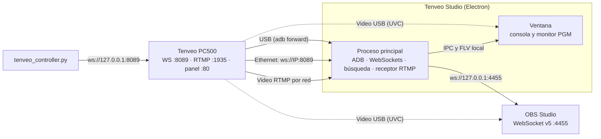

# Tenveo PC500 Studio Link: documentación del proyecto

## 1. ¿Qué es esto?

Es un conjunto de herramientas hechas a medida para **controlar desde la Mac el switcher de video Tenveo PC500** y combinarlo con **OBS Studio**.

El PC500 es un mezclador de video de 4 entradas con un sistema embebido que se ve por USB como un dispositivo ADB. Trae su propio panel web (puerto 80), un servidor **WebSocket en el puerto 8089** que intercambia mensajes JSON y un servidor **RTMP en el puerto 1935** para sus transmisiones. Analizamos ese panel web (ingeniería inversa) para entender el protocolo, y con eso construimos:

| Componente | Qué hace |
|---|---|
| **App de Electron "Tenveo Studio"** (`tenveo_electron/`) | Consola tipo broadcast: PGM/PVW, CUT/AUTO/FTB, T-Bar, capas (PIP, DSK, LOGO), mezclador, transmisión y grabación del equipo, video en vivo en el monitor PGM y control de OBS. Maneja el puente USB y la red por sí sola. **Es la versión principal.** |
| **Versión web** | La misma consola en el navegador, con un modo demo para probarla sin el equipo |
| **Scripts Python** | Control por línea de comandos y puente USB para la versión web |
| **Launcher `start_app.sh`** | Abre la app de Electron, la versión web o la app anterior de Flutter |
| **App de Flutter** (`tenveo_app/`, legado) | Versión anterior. Se conserva como referencia y ya no se desarrolla |
| **Archivos JS/HTML originales** | Copia del panel web del propio PC500, usada como referencia del protocolo |

> **¿Por qué Electron?** La app de Flutter necesita Xcode para compilarse en macOS, y esta Mac no puede instalarlo. Electron arma la app de Mac sin Xcode, sale para Intel y Apple Silicon a la vez y puede ejecutar `adb` y abrir conexiones de red por sí misma.

---

## 2. Cómo se conecta todo



Hay **dos rutas de control**:

1. **USB:** la app detecta el PC500 con `adb devices` y crea los reenvíos `tcp:8089 → tcp:8089` (WebSocket) y `tcp:8080 → tcp:80` (panel web original). No hay que configurar IP ni correr scripts. Al cerrar la app, quita los reenvíos.
2. **Red (Ethernet):** la app se conecta a `ws://<IP>:8089`. La IP se escribe en el diálogo de conexión, se encuentra con **Buscar en la red**, o la app la aprende sola cuando el equipo está conectado por USB.

El modo **Automático** usa USB si está conectado y, si no, la red. También se puede fijar **Solo USB** o **Solo red**.

El **video** puede llegar a la app por la red (RTMP), por USB (como cámara UVC) o no usarse. OBS sigue recibiendo el video por USB como siempre.

---

## 3. Estructura de la carpeta raíz

```
tenveopc500/
├── DOCUMENTACION.md        ← este documento
├── PENDIENTES.md           ← roadmap y pendientes
├── README.md               ← resumen rápido y features
├── start_app.sh            ← launcher: Electron, web o Flutter
├── tenveo_electron/        ← app de Electron (versión principal)
├── tenveo_app/             ← app de Flutter (legado)
├── TenveoStudio.app        ← acceso directo a la app de Flutter (legado)
├── tenveo_bridge.py        ← puente ADB para la versión web
├── tenveo_controller.py    ← control por terminal (CLI)
├── pc.html                 ┐
├── index.js                │ panel web ORIGINAL del PC500
├── util.js                 │ (solo referencia, no se ejecutan)
├── websocketUtil.js        ┘
└── .devcontainer/          ← configuración de GitHub Codespaces
```

### 3.1 Scripts de la raíz

#### [`start_app.sh`](start_app.sh)
- `./start_app.sh` abre la app de Electron. Busca primero `/Applications/Tenveo Studio.app`, después el paquete en `tenveo_electron/dist/` y, si no hay ninguno, la abre desde el código fuente con `npm start` (instala las dependencias la primera vez).
- `./start_app.sh --web` activa el puente USB (`adb forward` y `tenveo_bridge.py`), sirve la versión web en `http://localhost:8765` y abre el navegador. Con `Ctrl+C` se detiene todo.
- `./start_app.sh --flutter` abre la app anterior de Flutter con el puente USB.

#### [`tenveo_bridge.py`](tenveo_bridge.py)
Cada 5 s revisa `adb devices` y vuelve a aplicar el `adb forward` del 8089. Si desconectas y reconectas el USB, el puente vuelve solo. Al salir con `Ctrl+C` quita el forward. La app de Electron no lo necesita; sirve para la versión web y para la app de Flutter.

```bash
python3 tenveo_bridge.py
```

#### [`tenveo_controller.py`](tenveo_controller.py)
Controla el switcher desde la terminal (requiere `pip install websockets` y el forward activo):

```bash
python3 tenveo_controller.py status      # estado actual
python3 tenveo_controller.py cam 2       # cámara 2 a Preview
python3 tenveo_controller.py cut         # PVW → PGM
python3 tenveo_controller.py auto        # transición automática
python3 tenveo_controller.py ftb         # fade to black
python3 tenveo_controller.py switch 3    # cámara 3 directo al aire
```

#### `pc.html`, `index.js`, `util.js`, `websocketUtil.js`
Son el **panel web que trae el firmware del PC500**, descargado del equipo. Sirvieron para entender el protocolo:
- `websocketUtil.js` abre `ws://<host>:8089`, despacha los mensajes JSON y pinta cada botón con la clase CSS que manda el equipo.
- `index.js` arma la UI y envía `{"<id del control>": valor}`. Todos los botones de la página principal (`#layout_window`) se envían con el mismo código, `{"<id>": 1}`: cámaras, CUT, AUTO, FTB, STREAM, REC, PIP, DSK, LOGO, FREEZE y los demás.
- Las claves del protocolo son los `id` de los controles de `pc.html`: `pvw-1` … `pvw-aux`, `cut`, `auto`, `ftb`, `putter`, `audio_*_vol`, `audio_*_on`, `audio_in*_mode`, `stream-1-server`, `stream_2`, `rec`, `trans-effect`, `ndi_list`, `sys_ip`, etc.
- Cuando un canal de transmisión usa el servidor del propio equipo, el panel arma la dirección `rtmp://<IP del PC500>:1935/live/`.

---

## 4. La app de Electron (`tenveo_electron/`)

### 4.1 Arquitectura

```
tenveo_electron/
├── package.json                    ← dependencias, scripts y configuración del empaquetado
├── src/
│   ├── core/                       ← lógica compartida (Electron, navegador y pruebas)
│   │   ├── pc500-protocol.js       ← claves del protocolo, lectura de estado y comandos
│   │   ├── tenveo-service.js       ← WebSocket al PC500: rutas, latido, latencia y envío sin cola
│   │   ├── obs-service.js          ← cliente OBS WebSocket v5 con contraseña
│   │   ├── obs-auth.js             ← cálculo de la contraseña de OBS (SHA-256)
│   │   ├── studio-controller.js    ← comandos, SYNC OBS, configuración e IP aprendida
│   │   ├── simulators.js           ← simuladores del PC500 y de OBS (pruebas y modo demo)
│   │   ├── simulated-websocket.js  ← WebSocket falso para el modo demo
│   │   └── emitter.js              ← suscriptores de cambios
│   ├── main/                       ← proceso principal de Electron
│   │   ├── main.js                 ← ventana, protocolo app://, IPC, permisos y arranque
│   │   ├── adb-bridge.js           ← puente USB: busca adb, reenvía puertos y limpia al salir
│   │   ├── lan-discovery.js        ← busca el PC500 en la red local
│   │   ├── video-receiver.js       ← recibe el video RTMP y lo entrega como FLV local
│   │   ├── settings-store.js       ← configuración; contraseña de OBS cifrada en el llavero
│   │   └── vendor/node-media-server/ ← piezas del protocolo RTMP (Apache 2.0)
│   ├── preload/preload.cjs         ← puente seguro entre la ventana y el proceso principal
│   └── renderer/                   ← la consola: HTML, CSS y JavaScript sin frameworks
│       ├── index.html
│       ├── styles/app.css          ← tema oscuro minimalista
│       ├── vendor/mpegts/          ← reproductor de video FLV (Apache 2.0)
│       └── js/
│           ├── app.js              ← dibuja el estado y manda comandos
│           ├── video.js            ← video del monitor PGM: red o USB
│           ├── backend.js          ← elige Electron o navegador
│           └── local-backend.js    ← modo navegador y modo demo
├── dev/                            ← simuladores por WebSocket, emisor de video y capturas (solo pruebas)
├── scripts/                        ← start, web, mock, smoke y prepare-adb
└── test/                           ← pruebas automáticas (node --test)
```

Patrón: **Servicios** (I/O de red) → **Controlador** (estado y lógica) → **Ventana** (dibujo). En Electron, servicios y controlador corren en el proceso principal y la ventana recibe el estado por IPC. En el navegador corren dentro de la página. La única dependencia en tiempo de ejecución es `ws`; `electron`, `electron-builder`, `node-media-server` y `mpegts.js` son de desarrollo, y de los dos últimos solo se copian las piezas necesarias, con sus licencias.

Seguridad:
- La ventana corre con `contextIsolation` y `sandbox`, sin acceso a Node. Solo ve cuatro funciones del preload.
- La interfaz se sirve con el protocolo propio `app://tenveo`, que solo expone `renderer/` y `core/`.
- El proceso principal acepta solo comandos conocidos y solo de la ventana de la app.
- Solo la propia ventana puede pedir la cámara, y solo video.
- El receptor RTMP acepta solo la clave de esta Mac y un emisor a la vez; el video se entrega solo en 127.0.0.1.
- La página tiene una Content-Security-Policy estricta, y los nombres de escenas de OBS se insertan como texto.

### 4.2 Protocolo del PC500 ([`pc500-protocol.js`](tenveo_electron/src/core/pc500-protocol.js))

| Acción | Mensaje enviado | Control del panel original |
|---|---|---|
| Cámara a Preview | `{"pvw-3": 1}` | botones `pvw-1` … `pvw-aux` |
| CUT, AUTO, FTB | `{"cut": 1}`, `{"auto": 1}`, `{"ftb": 1}` | botones `cut`, `auto`, `ftb` |
| Cámara directo al aire | `pvw-N` y, 150 ms después, `cut` | combinación de los dos |
| T-Bar | `{"putter": 0…255}` mientras se arrastra | slider `putter` |
| Capas y equipo | `{"pip1-on-air": 1}`, `{"dsk": 1}`, `{"stream_2": 1}`, `{"rec": 1}`… | botones de la página principal |
| Destino de transmisión | `{"stream-2-server": …, "stream-2-key": …}` con los fps y la tasa actuales | botón `stream-2` de la pestaña de sistema |
| Volumen | `{"audio_in1_vol": -12}`, en dB de -60 a 0 | sliders `audio_*_vol` |
| Silencio de PGM y MIC 1 | `{"audio_pgm_on": 0}` (1 encendido, 0 apagado) | casillas `audio_*_on` |
| Silencio de IN 1 a IN 4 | `{"audio_in1_mode": 0}` (0 OFF, 1 ON, 2 AFV) | modos `audio_in*_mode` |

Lectura de estado, igual que `websocketUtil.js`:
- `pvw-N: "active-red"` → cámara N en **PGM**; `"active-green"` → en **PVW**.
- Cada botón del panel guarda su luz (`active-*` o `flash-*` con su color).
- `audio_<canal>_vol`, `audio_<canal>_on` y `audio_in<N>_mode` → volumen y estado de cada canal.
- `sys_ip`, `system_version`, `stream_time` y `record_time` → IP, firmware y tiempos de transmisión y grabación.

### 4.3 Comunicación por red ([`tenveo-service.js`](tenveo_electron/src/core/tenveo-service.js))
- **Baja latencia:** en el proceso principal la conexión usa la librería `ws`, sin compresión y con `TCP_NODELAY`.
- **Latido y latencia:** manda un ping cada 2 s y muestra la latencia de ida y vuelta en la barra superior. Si el equipo ya respondió algún ping y deja de responder 6 s, la app corta y reconecta sola, en vez de esperar minutos al sistema operativo. Un equipo que no contesta pings nunca pierde la conexión por esto.
- **Envío sin cola:** la T-Bar y los faders mandan siempre el último valor. Si la red se satura, se descartan los valores intermedios y nunca se acumula atraso. Un botón como CUT saca primero lo pendiente, así el orden se respeta.
- **Reconexión:** si la conexión se cae, reintenta de inmediato y después cada 4 s, sin olvidar la IP. Un cambio de modo o de IP mientras conecta nunca deja la conexión muerta.
- **Búsqueda en la red** ([`lan-discovery.js`](tenveo_electron/src/main/lan-discovery.js)): recorre la subred de cada interfaz de la Mac con 64 conexiones a la vez, prueba el puerto 8089 y confirma que el primer mensaje sea del PC500. Tarda unos segundos.
- **IP aprendida:** con el equipo conectado por USB, la app guarda la IP que informa el PC500 para seguir por red si se desconecta el cable. Nunca pisa una IP escrita a mano.

### 4.4 Video en el monitor PGM ([`video-receiver.js`](tenveo_electron/src/main/video-receiver.js) y [`video.js`](tenveo_electron/src/renderer/js/video.js))
Se elige en la pestaña **Equipo**:

| Fuente | Cómo funciona |
|---|---|
| **Red: el PC500 transmite a esta Mac** | La app abre un servidor RTMP en el puerto 1935. **Enviar video a esta Mac** configura el canal 2 de transmisión del PC500 con `rtmp://<IP de la Mac>:1935/live` y la clave de la app, y lo enciende. |
| **Red: leer el servidor RTMP del PC500** | **Enviar video a esta Mac** configura el canal 2 con el servidor del propio equipo (`rtmp://<IP del PC500>:1935/live/`) y la app lee `rtmp://<IP del PC500>:1935/live/<clave>`. |
| **USB: salida de video del PC500** | La app abre la salida UVC del equipo como cámara. macOS pide permiso la primera vez. |

El canal 1 de transmisión queda libre para YouTube u otra plataforma. El video de red no se recodifica: el receptor lo pasa a FLV y lo entrega en `127.0.0.1`, con la cabecera y el último GOP guardados para que la imagen aparezca al instante; la ventana lo reproduce con `mpegts.js` con persecución de latencia. La clave de video se genera sola la primera vez y se muestra, junto con la dirección, para configurarla a mano si hace falta.

### 4.5 OBS ([`obs-service.js`](tenveo_electron/src/core/obs-service.js))
Cliente del protocolo **OBS WebSocket v5** (por defecto `ws://127.0.0.1:4455`):
- Saludo: Hello (op 0) → Identify (op 1) → Identified (op 2).
- **Contraseña:** si OBS la pide, el Identify lleva `base64(sha256(base64(sha256(contraseña + salt)) + challenge))`. Si no coincide, OBS cierra con el código 4009 y la app lo avisa.
- Pide `GetStreamStatus`, `GetRecordStatus`, `GetVirtualCamStatus` y `GetSceneList`, y escucha sus cambios.
- Acciones: `ToggleStream`, `ToggleRecord`, `ToggleVirtualCam`, `SetCurrentProgramScene`.
- Con **SYNC OBS**, cuando cambia la cámara en PGM, la app pone al aire la escena de OBS cuyo nombre contenga `cam N`, `camN` o `camera N`. Nombra tus escenas `Cam 1`, `Cam 2`, `Cam 3`, `Cam 4`.

### 4.6 Puente USB ([`adb-bridge.js`](tenveo_electron/src/main/adb-bridge.js))
- Busca `adb` en este orden: copia incluida en la app, `vendor/`, `ANDROID_HOME` o `ANDROID_SDK_ROOT`, rutas comunes, el `PATH` y el shell de inicio del usuario.
- Cada 3 s revisa `adb devices -l` y prefiere un equipo real antes que un emulador de Android.
- Reenvía el 8089, que es obligatorio, y el 8080 → 80 del panel original.
- Al cerrar la app quita los reenvíos que creó.

### 4.7 Interfaz
- Barra superior: estado del PC500 con su latencia, estado de OBS, salidas de OBS (Live, Rec, Vcam), SYNC OBS y ajustes.
- Monitores PVW y PGM en 16:9; el PGM muestra el video en vivo cuando hay una fuente.
- Consola: buses Program y Preview, capas en dos filas como en el equipo, CUT, AUTO, FTB y T-Bar.
- Barra lateral con pestañas: **Audio** (mezclador), **OBS** (escenas) y **Equipo** (datos del PC500, transmisión y grabación del equipo, más controles y fuente de video).
- Atajos: las teclas 1 a 5 ponen la cámara en Preview. CUT y AUTO no tienen atajo a propósito, para que una tecla pulsada por error no cambie lo que está al aire.

### 4.8 Configuración
Se guarda en `~/Library/Application Support/Tenveo Studio/settings.json`. La contraseña de OBS se cifra con el llavero de macOS (`safeStorage`). En el navegador la configuración queda en el propio navegador y la contraseña solo dura la sesión.

### 4.9 Versión web y modo demo
- `npm run web` sirve la consola en `http://localhost:8765`. En este modo el puente USB lo abre `start_app.sh --web` o `tenveo_bridge.py`. El video por red y la búsqueda solo están en la app de Electron.
- Agregando `?demo` a la dirección, la consola usa simuladores del PC500 y de OBS dentro de la página, sin red. Sirve para probarla desde cualquier dispositivo o un Codespace.

### 4.10 Pruebas
```bash
cd tenveo_electron
npm test             # pruebas automáticas: protocolo, red, OBS, búsqueda, video, ADB y configuración
npm run smoke        # abre la app contra simuladores, pulsa botones y guarda una captura
npm run smoke:web    # lo mismo en modo navegador (SMOKE_WEB_DEMO=1 para el modo demo)
npm run smoke:video  # un emisor de prueba transmite H.264 por RTMP y la app lo muestra en el monitor PGM
npm run mock         # simuladores del PC500 y de OBS para trabajar sin el equipo
```
El emisor de prueba codifica una carta de ajuste en H.264 con el codificador de Chromium y la publica por RTMP, igual que el PC500 al transmitir. El simulador del PC500 imita el protocolo del panel original, pero no es el firmware real.

### 4.11 Builds disponibles

| Target | Cómo se genera | Resultado |
|---|---|---|
| **Mac universal** (Intel y Apple Silicon) | `npm run dist` | `dist/TenveoStudio-1.1.0-universal.dmg`, `.zip` y `dist/mac-universal/Tenveo Studio.app` |
| Solo Intel o solo Apple Silicon | `npm run dist:x64` o `npm run dist:arm64` | `.dmg` y `.zip` en `dist/` |
| **Web** | no se compila | `npm run web` o `./start_app.sh --web` |

No necesita Xcode. `npm run dist` copia el `adb` de la Mac dentro de la app (`scripts/prepare-adb.mjs`) junto con su aviso de licencia. La app lleva una firma provisional: en otra Mac hay que desbloquearla una vez con:

```bash
xattr -dr com.apple.quarantine "/Applications/Tenveo Studio.app"
```

---

## 5. Puertos usados

| Puerto | Dónde | Uso |
|---|---|---|
| `8089` | PC500 | WebSocket de control (JSON), por USB vía ADB o por red |
| `80` → `8080` | PC500 → `localhost` vía ADB | Panel web original del PC500 |
| `1935` | Mac | Servidor RTMP de la app, cuando el PC500 transmite a la Mac |
| `1935` | PC500 | Servidor RTMP del equipo, cuando la app lo lee |
| aleatorio | Mac, solo `127.0.0.1` | Video FLV entre el proceso principal y la ventana |
| `8765` | Mac | Versión web (`npm run web` o `start_app.sh --web`) |
| `4455` | Mac | OBS WebSocket v5 |
| `18089`, `14455` | Mac | Simuladores del PC500 y de OBS (`npm run mock`) |

---

## 6. Uso rápido

1. Conecta el PC500 por **USB** y, si quieres control y video por red, también por **Ethernet** a la misma red que la Mac.
2. Abre **OBS** y activa *Herramientas → Configuración del servidor WebSocket* (puerto 4455). Si le pones contraseña, escríbela en el diálogo de conexión.
3. Abre **Tenveo Studio**: doble clic en la app o `./start_app.sh`.
4. La barra superior debe decir **PC500 · USB** o **Red** en verde, con la latencia, y **OBS · Conectado**.
5. Para ver el video en el monitor PGM, en **Equipo** elige una fuente de red y pulsa **Enviar video a esta Mac**, o elige la salida USB.

macOS puede pedir tres permisos la primera vez:
- **Red local**, para conectarse al PC500 por Ethernet y buscarlo. Acéptalo.
- **Conexiones entrantes**, si el firewall está activo y eliges que el PC500 transmita a la Mac. Acéptalo.
- **Cámara**, si eliges la salida USB del PC500.

---

## 7. Limitaciones conocidas y pendientes

> [!WARNING]
> Las claves de comando salen del panel web original: son los `id` de sus controles, se envían con el mismo código que usa el panel y la lectura de estado copia `websocketUtil.js`. Aun así, nada se probó con el PC500 conectado: el silencio real, la T-Bar (`putter`), el destino de transmisión y el servidor RTMP del equipo tienen que confirmarse con el hardware. Si algo no responde, se ajusta en `pc500-protocol.js`.

- **Latencia del video por red:** RTMP suele quedar entre medio segundo y un segundo y medio detrás de la imagen real. Sirve para monitorear, no para reemplazar el multiview del equipo.
- **Firma de la app:** es provisional. Para repartirla sin avisos de seguridad hace falta una cuenta de desarrollador de Apple y notarización.
- **Vúmetros:** siguen la posición del fader. El PC500 no manda niveles de audio.
- **GPU:** en esta Mac Chromium no logra iniciar la GPU y dibuja por software. Funciona igual; los avisos que salen en la terminal son de eso.
- **NDI:** el firmware tiene las claves `ndi_name` y `ndi_list`, pero la app todavía no las controla.
- **Icono:** la app usa el icono por defecto de Electron.
- **App de Flutter (legado):** `tenveo_app/` ya no se desarrolla. Su compilación nativa necesita Xcode y su T-Bar puede mandar varios CUT en un solo arrastre.
