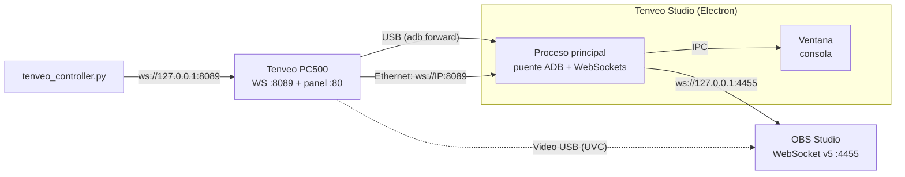

# Tenveo PC500 Studio Link: documentación del proyecto

## 1. ¿Qué es esto?

Es un conjunto de herramientas hechas a medida para **controlar desde la Mac el switcher de video Tenveo PC500** y combinarlo con **OBS Studio**.

El PC500 es un mezclador de video de 4 entradas con un sistema embebido que se ve por USB como un dispositivo ADB. Trae su propio panel web (puerto 80) y un servidor **WebSocket en el puerto 8089** que intercambia mensajes JSON. Analizamos ese panel web (ingeniería inversa) para entender el protocolo, y con eso construimos:

| Componente | Qué hace |
|---|---|
| **App de Electron "Tenveo Studio"** (`tenveo_electron/`) | Consola gráfica tipo broadcast: PGM/PVW, CUT/AUTO/FTB, T-Bar, mezclador de audio y control de OBS. Maneja el puente USB (ADB) por sí sola. **Es la versión principal.** |
| **Versión web** | La misma consola en el navegador, con un modo demo para probarla sin el equipo |
| **Scripts Python** | Control por línea de comandos y puente USB para la versión web |
| **Launcher `start_app.sh`** | Abre la app de Electron, la versión web o la app anterior de Flutter |
| **App de Flutter** (`tenveo_app/`, legado) | Versión anterior. Se conserva como referencia y ya no se desarrolla |
| **Archivos JS/HTML originales** | Copia del panel web del propio PC500, usada como referencia del protocolo |

> **¿Por qué Electron?** La app de Flutter necesita Xcode para compilarse en macOS, y esta Mac no puede instalarlo. Electron arma la app de Mac sin Xcode, sale para Intel y Apple Silicon a la vez y puede ejecutar `adb` por sí misma, sin scripts aparte.

---

## 2. Cómo se conecta todo



Hay **dos rutas de control**:

1. **USB (recomendada):** la app detecta el PC500 con `adb devices` y crea los reenvíos `tcp:8089 → tcp:8089` (WebSocket) y `tcp:8080 → tcp:80` (panel web original). No hay que configurar IP ni correr scripts. Al cerrar la app, quita los reenvíos.
2. **Ethernet:** si el PC500 está en red, la app se conecta directo a `ws://<IP>:8089`. La IP se escribe en el diálogo de conexión, que se abre con un clic en el indicador del PC500.

El **video** sigue llegando a OBS por USB como una webcam (UVC). Este software **no** procesa video; solo controla el switcher y OBS.

---

## 3. Estructura de la carpeta raíz

```
tenveopc500/
├── DOCUMENTACION.md        ← este documento
├── PENDIENTES.md           ← roadmap y pendientes
├── README.md               ← resumen rápido y features
├── start_app.sh            ← launcher: Electron, web o Flutter
├── tenveo_electron/        ← app de Electron (versión principal)
├── tenveo_app/             ← app de Flutter (legado)
├── TenveoStudio.app        ← acceso directo a la app de Flutter (legado)
├── tenveo_bridge.py        ← puente ADB para la versión web
├── tenveo_controller.py    ← control por terminal (CLI)
├── pc.html                 ┐
├── index.js                │ panel web ORIGINAL del PC500
├── util.js                 │ (solo referencia, no se ejecutan)
├── websocketUtil.js        ┘
└── .devcontainer/          ← configuración de GitHub Codespaces
```

### 3.1 Scripts de la raíz

#### [`start_app.sh`](start_app.sh)
- `./start_app.sh` abre la app de Electron. Busca primero `/Applications/Tenveo Studio.app`, después el paquete en `tenveo_electron/dist/` y, si no hay ninguno, la abre desde el código fuente con `npm start` (instala las dependencias la primera vez).
- `./start_app.sh --web` activa el puente USB (`adb forward` y `tenveo_bridge.py`), sirve la versión web en `http://localhost:8765` y abre el navegador. Con `Ctrl+C` se detiene todo.
- `./start_app.sh --flutter` abre la app anterior de Flutter con el puente USB.

#### [`tenveo_bridge.py`](tenveo_bridge.py)
Cada 5 s revisa `adb devices` y vuelve a aplicar el `adb forward` del 8089. Si desconectas y reconectas el USB, el puente vuelve solo. Al salir con `Ctrl+C` quita el forward. La app de Electron no lo necesita; sirve para la versión web y para la app de Flutter.

```bash
python3 tenveo_bridge.py
```

#### [`tenveo_controller.py`](tenveo_controller.py)
Controla el switcher desde la terminal (requiere `pip install websockets` y el forward activo):

```bash
python3 tenveo_controller.py status      # estado actual
python3 tenveo_controller.py cam 2       # cámara 2 a Preview
python3 tenveo_controller.py cut         # PVW → PGM
python3 tenveo_controller.py auto        # transición automática
python3 tenveo_controller.py ftb         # fade to black
python3 tenveo_controller.py switch 3    # cámara 3 directo al aire
```

#### `pc.html`, `index.js`, `util.js`, `websocketUtil.js`
Son el **panel web que trae el firmware del PC500**, descargado del equipo. Sirvieron para entender el protocolo:
- `websocketUtil.js` abre `ws://<host>:8089`, despacha los mensajes JSON y pinta cada botón con la clase CSS que manda el equipo.
- `index.js` arma la UI (layouts, PiP, logos, audio, multiview, streaming) y envía `{"<id del control>": valor}`.
- Las claves del protocolo son los `id` de los controles de `pc.html`: `pvw-1` … `pvw-aux`, `cut`, `auto`, `ftb`, `putter`, `audio_*_vol`, `audio_*_on`, `audio_in*_mode`, `trans-effect`, `stream-1-server`, `ndi_name`, `ndi_list`, `sys_ip`, `sys_dhcp`, etc.

---

## 4. La app de Electron (`tenveo_electron/`)

### 4.1 Arquitectura

```
tenveo_electron/
├── package.json                    ← dependencias, scripts y configuración del empaquetado
├── src/
│   ├── core/                       ← lógica compartida (Electron, navegador y pruebas)
│   │   ├── pc500-protocol.js       ← claves del protocolo, lectura de estado y comandos
│   │   ├── tenveo-service.js       ← WebSocket al PC500 + autoconexión USB/Ethernet
│   │   ├── obs-service.js          ← cliente OBS WebSocket v5 con contraseña
│   │   ├── obs-auth.js             ← cálculo de la contraseña de OBS (SHA-256)
│   │   ├── studio-controller.js    ← une PC500 y OBS: comandos, SYNC OBS y configuración
│   │   ├── simulators.js           ← simuladores del PC500 y de OBS (pruebas y modo demo)
│   │   ├── simulated-websocket.js  ← WebSocket falso para el modo demo
│   │   └── emitter.js              ← suscriptores de cambios
│   ├── main/                       ← proceso principal de Electron
│   │   ├── main.js                 ← ventana, protocolo app://, IPC y arranque
│   │   ├── adb-bridge.js           ← puente USB: busca adb, reenvía puertos y limpia al salir
│   │   └── settings-store.js       ← configuración; contraseña de OBS cifrada en el llavero
│   ├── preload/preload.cjs         ← puente seguro entre la ventana y el proceso principal
│   └── renderer/                   ← la consola: HTML, CSS y JavaScript sin frameworks
│       ├── index.html
│       ├── styles/app.css          ← tema oscuro broadcast (mismos colores que en Flutter)
│       └── js/
│           ├── app.js              ← dibuja el estado y manda comandos
│           ├── backend.js          ← elige Electron o navegador
│           └── local-backend.js    ← modo navegador y modo demo
├── dev/                            ← simuladores por WebSocket y captura web (solo pruebas)
├── scripts/                        ← start, web, mock, smoke y prepare-adb
└── test/                           ← pruebas automáticas (node --test)
```

Patrón: **Servicios** (I/O por WebSocket) → **Controlador** (estado y lógica) → **Ventana** (dibujo). En Electron, servicios y controlador corren en el proceso principal y la ventana recibe el estado por IPC. En el navegador corren dentro de la página. La app no tiene dependencias en tiempo de ejecución: `electron`, `electron-builder` y `ws` son solo de desarrollo.

Seguridad:
- La ventana corre con `contextIsolation` y `sandbox`, sin acceso a Node. Solo ve cuatro funciones del preload.
- La interfaz se sirve con el protocolo propio `app://tenveo`, que solo expone `renderer/` y `core/`.
- El proceso principal acepta solo comandos conocidos y solo de la ventana de la app.
- La página tiene una Content-Security-Policy estricta, y los nombres de escenas de OBS se insertan como texto.

### 4.2 Protocolo del PC500 ([`pc500-protocol.js`](tenveo_electron/src/core/pc500-protocol.js) y [`tenveo-service.js`](tenveo_electron/src/core/tenveo-service.js))

| Acción | Mensaje enviado | Control del panel original |
|---|---|---|
| Cámara a Preview | `{"pvw-3": 1}` | botones `pvw-1` … `pvw-aux` |
| CUT, AUTO, FTB | `{"cut": 1}`, `{"auto": 1}`, `{"ftb": 1}` | botones `cut`, `auto`, `ftb` |
| Cámara directo al aire | `pvw-N` y, 150 ms después, `cut` | combinación de los dos |
| T-Bar | `{"putter": 0…255}` mientras se arrastra | slider `putter` |
| Volumen | `{"audio_in1_vol": -12}`, en dB de -60 a 0 | sliders `audio_*_vol` |
| Silencio de PGM y MIC 1 | `{"audio_pgm_on": 0}` (1 encendido, 0 apagado) | casillas `audio_*_on` |
| Silencio de IN 1 a IN 4 | `{"audio_in1_mode": 0}` (0 OFF, 1 ON, 2 AFV) | modos `audio_in*_mode` |

- **Lectura de estado:** junta cada JSON que llega y deduce el estado, igual que `websocketUtil.js`:
  - `pvw-N: "active-red"` → cámara N en **PGM**
  - `pvw-N: "active-green"` → cámara N en **PVW**
  - `audio_<canal>_vol` → volumen en dB
  - `audio_<canal>_on` y `audio_in<N>_mode` → canal encendido, apagado o en AFV
  - `ftb`, `auto`, `cut` → encendidos cuando su clase empieza con `active` o `flash`
- **Autoconexión:** prueba primero `ws://127.0.0.1:8089` (USB) y luego la IP Ethernet si hay una. Si la conexión se cae, reintenta de inmediato y después cada 4 s, sin olvidar la IP.
- La T-Bar solo se mueve arrastrando la manija, para evitar saltos al aire. También responde a las flechas del teclado.

### 4.3 OBS ([`obs-service.js`](tenveo_electron/src/core/obs-service.js))
Cliente del protocolo **OBS WebSocket v5** (por defecto `ws://127.0.0.1:4455`):
- Saludo: Hello (op 0) → Identify (op 1) → Identified (op 2).
- **Contraseña:** si OBS la pide, el Identify lleva `base64(sha256(base64(sha256(contraseña + salt)) + challenge))`. Si no coincide, OBS cierra con el código 4009 y la app lo avisa en el panel de escenas.
- Pide `GetStreamStatus`, `GetRecordStatus`, `GetVirtualCamStatus` y `GetSceneList`.
- Escucha los eventos de stream, grabación, cámara virtual, cambio de escena y cambios en la lista de escenas.
- Acciones: `ToggleStream`, `ToggleRecord`, `ToggleVirtualCam`, `SetCurrentProgramScene`.
- Host, puerto y contraseña se cambian en el diálogo de conexión.

### 4.4 [`StudioController`](tenveo_electron/src/core/studio-controller.js): sincronización con OBS
Con **SYNC OBS** activo, cuando cambia la cámara en PGM (desde la app o desde los botones físicos del PC500), la app busca en OBS una escena cuyo nombre contenga `cam N`, `camN` o `camera N`, y la pone al aire.

> Para usarlo, nombra tus escenas de OBS como `Cam 1`, `Cam 2`, `Cam 3`, `Cam 4`.

### 4.5 Puente USB ([`adb-bridge.js`](tenveo_electron/src/main/adb-bridge.js))
- Busca `adb` en este orden: copia incluida en la app, `vendor/`, `ANDROID_HOME` o `ANDROID_SDK_ROOT`, rutas comunes, el `PATH` y el shell de inicio del usuario. Lo último hace falta porque una app abierta desde el Finder no hereda el `PATH` de la terminal.
- Cada 3 s revisa `adb devices -l` y prefiere un equipo real antes que un emulador de Android.
- Reenvía el 8089, que es obligatorio, y el 8080 → 80 del panel original. Si el 8080 está ocupado, sigue sin él.
- Al cerrar la app quita los reenvíos que creó.
- El diálogo de conexión muestra su estado: buscando adb, esperando el equipo, equipo sin autorizar, USB activo o error.

### 4.6 Configuración
Se guarda en `~/Library/Application Support/Tenveo Studio/settings.json`. La contraseña de OBS se cifra con el llavero de macOS (`safeStorage`); la primera vez macOS puede pedir permiso para usarlo. En el navegador la configuración queda en el propio navegador y la contraseña solo dura la sesión.

### 4.7 Versión web y modo demo
- `npm run web` sirve la consola en `http://localhost:8765`. En este modo el puente USB lo abre `start_app.sh --web` o `tenveo_bridge.py`.
- Agregando `?demo` a la dirección, la consola usa simuladores del PC500 y de OBS dentro de la página, sin red. Muestra la etiqueta **DEMO · SIMULADOR** y no guarda configuración. Sirve para probarla desde cualquier dispositivo o desde un Codespace.
- Para desarrollo, `?pc500=ws://host:puerto&obs=host:puerto` cambia las direcciones.

### 4.8 Pruebas
```bash
cd tenveo_electron
npm test             # pruebas automáticas: protocolo, servicios, OBS, controlador, ADB y configuración
npm run smoke        # abre la app contra simuladores, pulsa botones, revisa comandos y guarda una captura
npm run smoke:web    # lo mismo en modo navegador (SMOKE_WEB_DEMO=1 para el modo demo)
npm run mock         # simuladores del PC500 y de OBS para trabajar sin el equipo
```
El simulador del PC500 imita el protocolo del panel original, pero no es el firmware real. Las pruebas confirman que la app manda las claves del panel; no reemplazan una prueba con el equipo.

### 4.9 Builds disponibles

| Target | Cómo se genera | Resultado |
|---|---|---|
| **Mac universal** (Intel y Apple Silicon) | `npm run dist` | `dist/TenveoStudio-1.0.0-universal.dmg`, `.zip` y `dist/mac-universal/Tenveo Studio.app` |
| Solo Intel o solo Apple Silicon | `npm run dist:x64` o `npm run dist:arm64` | `.dmg` y `.zip` en `dist/` |
| **Web** | no se compila | `npm run web` o `./start_app.sh --web` |

No necesita Xcode. `npm run dist` copia el `adb` de la Mac dentro de la app (`scripts/prepare-adb.mjs`) junto con su aviso de licencia. La app lleva una firma provisional: en otra Mac hay que desbloquearla una vez con:

```bash
xattr -dr com.apple.quarantine "/Applications/Tenveo Studio.app"
```

---

## 5. Puertos usados

| Puerto | Dónde | Uso |
|---|---|---|
| `8089` | PC500 → `localhost` vía ADB | WebSocket de control (JSON) |
| `80` → `8080` | PC500 → `localhost` vía ADB | Panel web original del PC500 |
| `8765` | Mac | Versión web (`npm run web` o `start_app.sh --web`) |
| `4455` | Mac | OBS WebSocket v5 |
| `18089`, `14455` | Mac | Simuladores del PC500 y de OBS (`npm run mock`) |

---

## 6. Uso rápido

1. Conecta el PC500 por **USB** (y por **Ethernet** si quieres).
2. Abre **OBS** y activa *Herramientas → Configuración del servidor WebSocket* (puerto 4455). Si le pones contraseña, escríbela en el diálogo de conexión de la app.
3. Abre **Tenveo Studio**: doble clic en la app o `./start_app.sh`.
4. El indicador de la barra superior debe decir **PC500: USB** o **Ethernet** en verde, y el panel de escenas **LINKED**.

---

## 7. Limitaciones conocidas y pendientes

> [!WARNING]
> Las claves de comando salen del panel web original: son los `id` de sus botones y sliders, y la lectura de estado copia lo que hace `websocketUtil.js`. Aun así, el código que envía los botones de cámara, CUT, AUTO y FTB no está en los archivos capturados, y la T-Bar (`putter`) y el silencio real (`audio_*_on`, `audio_in*_mode`) todavía no se probaron con el equipo. Hay que confirmarlos con el hardware conectado y ajustar `pc500-protocol.js` si algo no responde.

- **Firma de la app:** es provisional. Para repartirla sin avisos de seguridad hace falta una cuenta de desarrollador de Apple y notarización.
- **Vúmetros:** siguen la posición del fader. El PC500 no manda niveles de audio; los reales tendrían que venir de OBS.
- **GPU:** en esta Mac Chromium no logra iniciar la GPU y dibuja por software. Funciona igual; los avisos que salen en la terminal son de eso.
- **NDI:** el firmware tiene las claves `ndi_name` y `ndi_list`, pero la app todavía no las controla.
- **Icono:** la app usa el icono por defecto de Electron.
- **App de Flutter (legado):** `tenveo_app/` ya no se desarrolla. Su compilación nativa necesita Xcode y su T-Bar puede mandar varios CUT en un solo arrastre.
