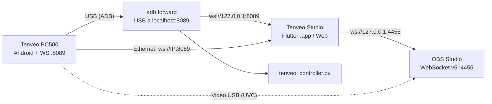

# Tenveo PC500 Studio Link: documentación del proyecto

## 1. ¿Qué es esto?

Es un conjunto de herramientas hechas a medida para **controlar desde la Mac el switcher de video Tenveo PC500** y combinarlo con **OBS Studio**.

El PC500 es un mezclador de video de 4 entradas que por dentro corre Android. Trae su propio panel web (puerto 80) y un servidor **WebSocket en el puerto 8089** que intercambia mensajes JSON. Analizamos ese panel web (ingeniería inversa) para entender el protocolo, y con eso construimos:

| Componente | Qué hace |
|---|---|
| **App Flutter "Tenveo Studio"** | Consola gráfica tipo broadcast: PGM/PVW, CUT/AUTO/FTB, T-Bar, faders de audio y control de OBS |
| **Scripts Python** | Control por línea de comandos y puente USB (ADB) |
| **Launcher `start_app.sh`** | Arranque "plug & play": puente USB, servidor web local y apertura del navegador |
| **Archivos JS/HTML originales** | Copia del panel web del propio PC500, usada como referencia del protocolo |

---

## 2. Cómo se conecta todo



Hay **dos rutas de control**:

1. **USB (recomendada):** el PC500 aparece como dispositivo ADB. `adb forward tcp:8089 tcp:8089` expone su WebSocket en `127.0.0.1:8089` de la Mac. No hay que configurar ninguna IP.
2. **Ethernet:** si el PC500 está en red (DHCP), la app se conecta directo a `ws://<IP>:8089`. La IP se escribe en el botón de configuración de la app.

El **video** sigue llegando a OBS por USB como una webcam (UVC). Este software **no** procesa video; solo controla el switcher y OBS.

---

## 3. Estructura de la carpeta raíz

```
tenveopc500/
├── DOCUMENTACION.md        ← este documento
├── README.md               ← resumen rápido y features
├── start_app.sh            ← launcher plug & play (Nativo y Web)
├── TenveoStudio.app        ← acceso directo a la app nativa de macOS
├── tenveo_bridge.py        ← puente ADB persistente (reconecta solo)
├── tenveo_controller.py    ← control por terminal (CLI)
├── pc.html                 ┐
├── index.js                │ panel web ORIGINAL del PC500
├── util.js                 │ (solo referencia, no se ejecutan)
├── websocketUtil.js        ┘
└── tenveo_app/             ← proyecto Flutter
```

### 3.1 Scripts de la raíz

#### [`start_app.sh`](file:///Volumes/1TB/DEVS/tenveopc500/start_app.sh)
Arranque en un solo paso con detección automática:
1. Activa el puente ADB USB (`tcp:8089` y `tcp:8080`).
2. Por defecto abre la **aplicación nativa de macOS** ([`TenveoStudio.app`](file:///Volumes/1TB/DEVS/tenveopc500/TenveoStudio.app)) y mantiene el monitor de reconexión USB activo.
3. Si ejecutas `./start_app.sh --web`, levanta el servidor web local en `http://localhost:8765` y lo abre en tu navegador. Con `Ctrl+C` se detiene todo limpiamente.

#### [`tenveo_bridge.py`](file:///Volumes/1TB/DEVS/tenveopc500/tenveo_bridge.py)
Cada 5 s revisa `adb devices` y vuelve a aplicar el `adb forward` del 8089. Si desconectas y reconectas el USB, el puente vuelve solo. Al salir con `Ctrl+C` quita el forward.

```bash
python3 tenveo_bridge.py
```

#### [`tenveo_controller.py`](file:///Volumes/1TB/DEVS/tenveopc500/tenveo_controller.py)
Controla el switcher desde la terminal (requiere `pip install websockets` y el forward activo):

```bash
python3 tenveo_controller.py status      # estado actual
python3 tenveo_controller.py cam 2       # cámara 2 a Preview
python3 tenveo_controller.py cut         # PVW → PGM
python3 tenveo_controller.py auto        # transición automática
python3 tenveo_controller.py ftb         # fade to black
python3 tenveo_controller.py switch 3    # cámara 3 directo al aire
```

#### `pc.html`, `index.js`, `util.js`, `websocketUtil.js`
Son el **panel web que trae el firmware del PC500**, descargado del equipo. Sirvieron para entender el protocolo:
- `websocketUtil.js` abre `ws://<host>:8089` y despacha los mensajes JSON.
- `index.js` arma la UI (layouts, PiP, logos, audio, multiview, streaming).
- Ahí aparecen claves como `to_switch_pvw_pgm`, `trans-effect`, `mode`, `audio_source`, `stream-1-server`, `ndi_name`, `ndi_list`, `sys_ip`, `sys_dhcp`, etc.

---

## 4. La app Flutter (`tenveo_app/`)

### 4.1 Arquitectura

```
lib/
├── main.dart                         ← arranque, Provider y tema
├── models/
│   ├── switcher_state.dart           ← estado del PC500 (PGM, PVW, audio, conexión)
│   └── obs_state.dart                ← estado de OBS (stream, rec, vcam, escenas)
├── services/
│   ├── tenveo_service.dart           ← WebSocket al PC500 + autoconexión USB/Ethernet
│   └── obs_service.dart              ← cliente OBS WebSocket v5
├── providers/
│   └── switcher_provider.dart        ← une ambos servicios y sincroniza OBS
└── ui/
    ├── theme/broadcast_theme.dart    ← tema oscuro estilo broadcast
    ├── screens/switcher_studio_screen.dart  ← pantalla principal
    └── widgets/
        ├── tally_button.dart         ← botones de cámara (tally rojo/verde)
        ├── tbar_fader.dart           ← T-Bar de transición
        ├── audio_fader.dart          ← faders + vúmetros + mute
        └── status_header.dart        ← barra superior: conexión, OBS, configuración
```

Patrón: **Servicios** (I/O por WebSocket) → **Provider** (estado y lógica) → **UI** (widgets). Dependencias: `web_socket_channel`, `provider`, `google_fonts`, `http`.

### 4.2 [`TenveoService`](file:///Volumes/1TB/DEVS/tenveopc500/tenveo_app/lib/services/tenveo_service.dart)
- **Autoconexión:** prueba primero `ws://127.0.0.1:8089` (USB) y luego la IP Ethernet si se configuró una. Si se cae, reintenta cada 4 s.
- **Lectura de estado:** junta cada JSON que llega en un `rawState` y deduce:
  - `pvw-N: "active-red"` → cámara N en **PGM**
  - `pvw-N: "active-green"` → cámara N en **PVW**
  - `audio_<canal>_vol` → volumen en dB
  - `ftb`, `auto`, `cut` → estado de los botones
- **Comandos:** `selectCamera`, `cut`, `auto`, `ftb`, `switchLive` (PVW + CUT con 150 ms de espera) y `setAudioVolume`.
- No usa `dart:io`, así que el mismo código corre en web y en macOS. El `adb forward` lo hace un proceso externo (`start_app.sh` o `tenveo_bridge.py`).

### 4.3 [`ObsService`](file:///Volumes/1TB/DEVS/tenveopc500/tenveo_app/lib/services/obs_service.dart)
Cliente del protocolo **OBS WebSocket v5** (`ws://127.0.0.1:4455`):
- Handshake: Hello (op 0) → Identify (op 1) → Identified (op 2).
- Pide `GetStreamStatus`, `GetRecordStatus`, `GetVirtualCamStatus` y `GetSceneList`.
- Escucha eventos de stream, grabación, cámara virtual y cambio de escena.
- Acciones: `ToggleStream`, `ToggleRecord`, `ToggleVirtualCam`, `SetCurrentProgramScene`.

### 4.4 [`SwitcherProvider`](file:///Volumes/1TB/DEVS/tenveopc500/tenveo_app/lib/providers/switcher_provider.dart): sincronización con OBS
Con **SYNC OBS** activo, cuando cambia la cámara en PGM (desde la app o desde los botones físicos del PC500), la app busca en OBS una escena cuyo nombre contenga `cam N`, `camN` o `camera N`, y la pone al aire.

> Para usarlo, nombra tus escenas de OBS como `Cam 1`, `Cam 2`, `Cam 3`, `Cam 4`.

### 4.5 Builds disponibles

| Target | Ubicación | Cómo se usa |
|---|---|---|
| **macOS nativa** | `tenveo_app/build/TenveoStudio.app` (x86_64, "Tenveo PC500 Studio Link") | Doble clic. Necesita el puente ADB corriendo aparte |
| **Web** | `tenveo_app/build/web` | `./start_app.sh` y se abre en el navegador |

Para recompilar:

```bash
cd tenveo_app
flutter build web --release      # versión web
flutter build macos --release    # versión .app (requiere Xcode)
```

---

## 5. Puertos usados

| Puerto | Dónde | Uso |
|---|---|---|
| `8089` | PC500 → `localhost` vía ADB | WebSocket de control (JSON) |
| `80` → `8080` | PC500 → `localhost` vía ADB | Panel web original del PC500 |
| `8765` | Mac | Servidor local de la app web (`start_app.sh`) |
| `4455` | Mac | OBS WebSocket v5 |

---

## 6. Uso rápido

1. Conecta el PC500 por **USB** (y por **Ethernet** si quieres).
2. Abre **OBS** y activa *Herramientas → Configuración del servidor WebSocket* (puerto 4455, **sin contraseña**; ver limitaciones).
3. Elige una opción:
   - **Web:** `./start_app.sh`
   - **App nativa:** `python3 tenveo_bridge.py` en una terminal y luego abre `TenveoStudio.app`.
4. El indicador de la barra superior debe decir **USB** o **Ethernet** en verde.

---

## 7. Limitaciones conocidas y pendientes

> [!WARNING]
> Algunas claves de comando que usa la app (`pvw-N`, `cut`, `auto`, `ftb`, `audio_<canal>_vol`) se dedujeron del análisis y **no aparecen literalmente** en el JS original del panel web, que usa por ejemplo `to_switch_pvw_pgm`. Hay que confirmarlas con el hardware conectado y ajustar `TenveoService` si el equipo no responde.

- **Contraseña de OBS:** `ObsService` todavía no implementa la autenticación (challenge/salt SHA-256). Por ahora hay que desactivar la contraseña del WebSocket de OBS.
- **ADB externo:** ni la versión web ni la `.app` (que corre en sandbox) pueden ejecutar `adb` por sí solas; siempre hace falta `start_app.sh` o `tenveo_bridge.py`.
- **`adb` necesario:** instálalo con `brew install android-platform-tools`.
- **NDI:** el firmware del PC500 tiene claves `ndi_name` y `ndi_list` en su panel, pero la app todavía no las controla.
- **T-Bar:** el fader está en la UI; falta confirmar el comando exacto de posición en el protocolo del equipo.
- **Arquitectura de la `.app`:** se compiló para x86_64 (en Apple Silicon corre con Rosetta).
