# Roadmap y Funcionalidades Pendientes — Tenveo PC500 Studio Link

Este documento detalla el estado actual del proyecto, las funciones implementadas y todo lo que falta por desarrollar, categorizado por área y nivel de prioridad.

---

## 📊 Estado Actual: ¿Qué está listo y probado?

- [x] **Ingeniería inversa del protocolo:** Identificación del SoC Rockchip RV1126, Linux embebido, daemon `t4_daemon` y WebSocket JSON en puerto `8089`.
- [x] **Conmutación básica en vivo:** Selección de cámaras (1, 2, 3, 4, AUX) en Preview, transiciones CUT, AUTO y FTB (Fade to Black).
- [x] **Sincronización bidireccional:** Cambios reflejados en LEDs físicos y en la interfaz en tiempo real.
- [x] **Consola gráfica Flutter:** Panel estilo broadcast con buses PGM/PVW, fader T-Bar táctil, faders de audio con vúmetros y panel de control de OBS.
- [x] **Integración OBS Studio (v5):** Control de Stream, Grabación, Cámara Virtual y sincronización automática de escenas al cambiar de cámara.
- [x] **Doble objetivo de compilación:**
  - Versión Web lista en `build/web` (ejecutable vía `./start_app.sh --web`).
  - Aplicación nativa macOS [`TenveoStudio.app`](file:///Volumes/1TB/DEVS/tenveopc500/TenveoStudio.app) firmada y funcional sin requerir instalación de Xcode.
- [x] **Automatización Plug & Play:** Script [`start_app.sh`](file:///Volumes/1TB/DEVS/tenveopc500/start_app.sh) y monitor de reconexión USB [`tenveo_bridge.py`](file:///Volumes/1TB/DEVS/tenveopc500/tenveo_bridge.py).

---

## 🎯 Lo que falta por implementar

### 1. Video en Vivo en la Interfaz (Multiview Real)
Actualmente, los monitores de **PROGRAM (PGM)** y **PREVIEW (PVW)** en la app muestran paneles de estado y placeholders estilizados, pero **no el flujo de video en tiempo real**.

- [ ] **Captura de video USB (UVC):** Integrar un reproductor de cámara web nativo en Flutter (usando `camera_macos` o `flutter_webrtc`) para desplegar la salida PGM del Tenveo directamente en el monitor de la app.
- [ ] **Multiview por red (RTSP / HTTP / WebRTC):** El PC500 genera streams de video por red. Se puede capturar el stream RTSP/HTTP local y renderizar el multiview de las 4 cámaras en miniatura.
- [ ] **Baja latencia:** Asegurar que el pipeline de video tenga menos de 100 ms de retraso para monitoreo en vivo confiable.

---

### 2. Protocolo Extendido del Hardware Tenveo PC500
El análisis del firmware original (`index.js` y `pc.html`) reveló comandos adicionales que el hardware soporta pero la app aún no controla:

- [ ] **Efectos de Transición (Wipe, Mix, Dip):**
  - Mapear la clave `trans-effect` (soporta más de 30 patrones de cortinilla/wipe).
  - Configurar duración de transición (`trans_interval`) y suavizado de bordes (`trans_softness`).
  - Configurar color del Dip (`dip_color`, `dip_mode`).
- [ ] **Posición precisa del T-Bar:** Enviar el valor analógico continuo (0 a 100%) al switcher durante el arrastre manual del fader, no solo al llegar al tope.
- [ ] **Capas PiP (Picture in Picture):**
  - Activar/desactivar `pip1` y `pip2` (`pip1-on-air`, `pip2-on-air`).
  - Posicionamiento, tamaño y recorte de las ventanas PiP.
- [ ] **Logos y Overlays (DSK / GFX):**
  - Carga y activación de logos en pantalla (`logo1`, `logo2`, `gfx_logo`, `dsk`).
- [ ] **Mezclador de Audio Avanzado:**
  - Mute por canal (`audio_pgm_on`, `audio_inX_mode`).
  - Modo AFV (*Audio Follows Video*): Activar automáticamente el audio de la cámara que esté al aire.
  - Ajuste de retardo de audio por entrada (`audio_in1_delay` a `in4_delay`) para compensar desincronización labial (Lip-Sync).
- [ ] **Grabador y Emisor RTMP Interno del PC500:**
  - Control de grabación directa en tarjeta SD / USB del equipo (`record_time`, espacio libre `udisk-space`, `sdcard-space`).
  - Configuración y arranque de streaming RTMP autónomo (`stream-1`, `stream-2`, servidores y claves de transmisión) sin depender de OBS.
- [ ] **Ajustes de Sistema del Hardware:**
  - Brillo de LEDs físicos (`sys_keyledlight`).
  - Control de ventilador interno (`sys_fan`) y retroiluminación (`sys_backlight`).
  - Configuración de red IP/DHCP (`sys_ip`, `sys_dhcp`, `sys_gateway`, `sys_netmask`).

---

### 3. Integración con OBS Studio
- [ ] **Autenticación con contraseña (OBS WebSocket v5):**
  - Implementar el handshake criptográfico SHA-256 (`challenge` + `salt`) en [ObsService](file:///Volumes/1TB/DEVS/tenveopc500/tenveo_app/lib/services/obs_service.dart) para permitir conectar a OBS cuando tiene contraseña activa.
- [ ] **Mapeo personalizado de escenas:**
  - Permitir al usuario vincular en una ventana de ajustes cada botón del PC500 (Cam 1..4, Aux) con cualquier escena de OBS, sin obligar a que se llamen exactamente `Cam 1`, `Cam 2`, etc.
- [ ] **Soporte para Modo Estudio de OBS (*Studio Mode*):**
  - Sincronizar el bus Preview de la app con la escena de Previsualización de OBS, y ejecutar transición en OBS al presionar CUT/AUTO en el Tenveo.
- [ ] **Vúmetros de audio de OBS:**
  - Reflejar los niveles de audio reales de OBS en los faders de la consola.

---

### 4. Flujos NDI | HX
- [ ] **Detección de fuentes NDI en la red:**
  - Explorar las claves `ndi_list` y `ndi_name` del PC500 para permitir que la entrada AUX tome feeds NDI de la red local.
- [ ] **Extracción/Recepción NDI en la Mac:**
  - Si el PC500 expone su salida PGM por NDI, añadir un receptor NDI ligero en la Mac para capturarlo sin cables USB.

---

### 5. Empaque, Distribución y Experiencia de Usuario en macOS
- [ ] **ADB embebido (sin dependencia de terminal):**
  - Incluir el binario compilado de `adb` dentro de `TenveoStudio.app/Contents/Resources/` y levantarlo directamente desde el código de la app, eliminando la necesidad de correr scripts en la terminal.
- [ ] **Compilación Universal / Apple Silicon (ARM64 nativo):**
  - Compilar el binario ejecutable nativo para ARM64 (`darwin-arm64`) para que funcione en chips M1/M2/M3/M4 sin requerir emulación Rosetta 2.
- [ ] **Icono oficial de la aplicación:**
  - Diseñar y asignar el archivo `.icns` de alta resolución al bundle `TenveoStudio.app`.
- [ ] **Instalador `.dmg` drag-and-drop:**
  - Crear una imagen de disco `.dmg` con acceso directo a `/Applications` para instalación en un clic.

---

## 🗓️ Plan de Implementación Sugerido por Fases

```mermaid
gantt
    title Plan de Desarrollo Tenveo PC500 Studio Link
    dateFormat  X
    axisFormat %s

    section Fase 1: Esenciales
    Autenticación OBS con contraseña        :active, p1, 0, 2
    Mapeo personalizado de escenas OBS     :p2, 1, 3
    Mute y Audio Follows Video (AFV)        :p3, 2, 4
    Binario nativo ARM64 (Apple Silicon)    :p4, 3, 5

    section Fase 2: Hardware Completo
    T-Bar analógico continuo                :p5, 4, 7
    Transiciones Wipe, Mix y Dip            :p6, 5, 8
    Capas PiP y control de Logos            :p7, 6, 9
    ADB embebido en el .app                 :p8, 7, 10

    section Fase 3: Video y Emisión
    Monitor con Video en Vivo (UVC/RTSP)    :p9, 9, 13
    Control de Grabación/Streaming interno  :p10, 11, 14
    Soporte NDI | HX                        :p11, 12, 15
    Empaque final en archivo .dmg           :p12, 14, 16
```

