# Roadmap y Funcionalidades Pendientes — Tenveo PC500 Studio Link

Este documento detalla el estado actual del proyecto, las funciones implementadas y todo lo que falta por desarrollar, categorizado por área y nivel de prioridad.

> **17 de octubre de 2026:** la consola pasó de Flutter a **Electron** (`tenveo_electron/`), y la versión **1.1.0** sumó comunicación por red optimizada, control de todos los botones del panel, video en vivo en el monitor PGM y una interfaz nueva. La app de Flutter (`tenveo_app/`) queda como legado.
>
> **18 de octubre de 2026 (1.2.0):** probada con un **PC500 real** por cable directo: conexión por IPv6 de enlace local, lectura de estado, Preview, STREAM y video 1080p60 en el monitor PGM por adb en red.
>
> **18 de octubre de 2026 (1.3.0):** **todo por red** (sin USB ni modos), Electron 43 para recuperar la GPU en esta Mac y un monitor PGM nuevo con WebCodecs. Con el PC500 real: de 36 % de cuadros perdidos a 0 %, ventana fluida a 60 cuadros/s y CPU de 149 % a 41 %. Lo marcado como "probado con simulador" todavía falta confirmarlo con el equipo.

---

## 📊 Estado Actual: ¿Qué está listo y probado?

- [x] **Ingeniería inversa del protocolo:** Identificación del SoC Rockchip RV1126, Linux embebido, daemon `t4_daemon` y WebSocket JSON en puerto `8089`. Las claves del protocolo son los `id` de los controles del panel web original, y todos los botones de su página principal se envían como `{"id": 1}`.
- [x] **Conmutación básica en vivo:** Selección de cámaras (1, 2, 3, 4, AUX) en Preview, transiciones CUT, AUTO y FTB (Fade to Black).
- [x] **Sincronización bidireccional:** Cambios reflejados en LEDs físicos y en la interfaz en tiempo real.
- [x] **Migración a Electron:** Consola completa en [`tenveo_electron/`](tenveo_electron/).
- [x] **Interfaz minimalista:** PGM grande en 16:9 y PVW como tarjeta, consola en grilla que llena el ancho, barra lateral con pestañas de Audio, OBS y Equipo. Revisada con capturas en cada estado, en el tamaño mínimo, en 1920×1080 y en una pantalla 5K (`scripts/screenshots.mjs`).
- [x] **Comunicación por red optimizada:** una sola ruta por red; búsqueda automática del PC500 (IPv4 e IPv6); latido cada segundo con latencia visible; corte detectado en 3,5 s; reintentos de 250 ms a 2 s. **Probado con el PC500 real** por cable directo, con mediciones contra la 1.0.0 (DOCUMENTACION.md, sección 8).
- [x] **Cable directo PC500 ↔ Mac:** control por IPv6 de enlace local y video por adb en red, sin configurar la red de la Mac. **Probado con el PC500 real.**
- [x] **Fluidez (1.3.0):** GPU recuperada (Electron 43), monitor PGM en un worker con WebCodecs, interfaz que solo toca el DOM donde algo cambió, Preview marcado en el mismo cuadro del clic. Medido con `bench-video` (DOCUMENTACION.md, sección 8).
- [x] **Control de todo el panel principal:** PIP, DSK, LOGO, CHROMA, LUMA, ON AIR, SET, STREAM, REC, FREEZE, SHOT, MODE, LOCK, MUTE y USER, con sus luces. STREAM probado con el PC500 real; el resto, con simulador. STREAM 2 se quitó: el firmware lo tiene desactivado.
- [x] **Video en el monitor PGM:** del servidor interno del PC500, **probado con el PC500 real** con cámaras: 1080p60, 0 cuadros perdidos. Se recupera solo si el decodificador falla.
- [x] **Integración OBS Studio (v5):** Stream, Grabación, Cámara Virtual, escenas y sincronización automática, con contraseña.
- [x] **Compilación sin Xcode:** App de Mac universal (Intel y Apple Silicon) en `.dmg` y `.zip` con `npm run dist`; versión web con modo demo.
- [x] **Plug & Play:** la app busca sola el PC500 en la red e incluye `adb` para el video por cable directo.
- [x] **Pruebas automáticas:** 91 pruebas del protocolo, la red, IPv6, OBS, la búsqueda, el video, adb, la configuración y la sintaxis, más pruebas de humo de la app, la versión web, el modo demo y el video con STREAM. Diagnóstico (`check-device`) y mediciones (`bench-network`, `bench-video`) con el equipo real.

---

## 🎯 Lo que falta por implementar

### 1. Video en Vivo en la Interfaz (Multiview Real)

- [x] **Video por red:** lectura del servidor RTMP interno del PC500 (SRS), sin recodificar, con un monitor de baja latencia (WebCodecs).
- [x] **Confirmado con el equipo:** el servidor interno responde en `rtmp://<IP>:1935/live/<clave>` (solo IPv4) y con STREAM el equipo publica sus dos destinos a la vez. Visto con cámaras: 1080p60 a 11,6 Mbit/s.
- [ ] **Bajar la latencia del SRS del PC500:** manda el video a ráfagas cada ~350 ms. Con `min_latency on` (o `mw_latency 0`) en su configuración se ganarían unos 350 ms. Exige `adb shell` en el equipo, que el control de permisos de Claude Code bloqueó: falta que el usuario lo autorice, y hacerlo con copia de seguridad de la configuración y reiniciando solo el SRS.
- [ ] **Multiview de las 4 cámaras:** El PC500 solo transmite el programa. Ver cada cámara exigiría otra fuente, por ejemplo NDI.

---

### 2. Protocolo Extendido del Hardware Tenveo PC500
El análisis del firmware original (`index.js` y `pc.html`) reveló comandos adicionales que el hardware soporta:

- [ ] **Efectos de Transición (Wipe, Mix, Dip):**
  - Mapear la clave `trans-effect` (soporta más de 30 patrones de cortinilla/wipe).
  - Configurar duración de transición (`trans_interval`) y suavizado de bordes (`trans_softness`).
  - Configurar color del Dip (`dip_color`, `dip_mode`).
- [x] **Posición precisa del T-Bar:** La app envía `putter` de 0 a 255 durante el arrastre. Probado con simulador; falta con el equipo (sale al aire).
- [ ] **Capas PiP (Picture in Picture):**
  - [x] Activar y desactivar `pip1`, `pip2`, `pip1-on-air`, `pip2-on-air`, DSK, CHROMA y LUMA desde la consola.
  - [ ] Posicionamiento, tamaño y recorte de las ventanas PiP.
- [ ] **Logos y Overlays (DSK / GFX):**
  - [x] Encender y apagar `logo1` y `logo2`.
  - [ ] Cargar imágenes de logos (`gfx_logo`).
- [ ] **Mezclador de Audio Avanzado:**
  - [x] Mute por canal con los controles del panel. Probado con simulador; falta con el equipo (afecta el audio al aire).
  - [ ] Modo AFV (*Audio Follows Video*): la app muestra cuando un canal está en AFV; falta poder activarlo.
  - [ ] Ajuste de retardo de audio por entrada (`audio_in1_delay` a `in4_delay`).
- [ ] **Grabador y Emisor RTMP Interno del PC500:**
  - [x] Encender y apagar STREAM y REC, y ver sus tiempos. La app lee los dos destinos de STREAM y nunca los cambia.
  - [ ] Mostrar el espacio libre (`udisk-space`, `sdcard-space`) y elegir dónde grabar.
  - [ ] Editar servidores y claves de transmisión para YouTube u otras plataformas desde la app, con confirmación (el equipo transmite a los dos destinos a la vez).
- [ ] **Ajustes de Sistema del Hardware:**
  - Brillo de LEDs físicos (`sys_keyledlight`).
  - Control de ventilador interno (`sys_fan`) y retroiluminación (`sys_backlight`).
  - Configuración de red IP/DHCP (`sys_ip`, `sys_dhcp`, `sys_gateway`, `sys_netmask`).

---

### 3. Integración con OBS Studio
- [x] **Autenticación con contraseña (OBS WebSocket v5).**
- [ ] **Mapeo personalizado de escenas:**
  - Permitir vincular cada botón del PC500 (Cam 1..4, Aux) con cualquier escena de OBS, sin obligar a que se llamen `Cam 1`, `Cam 2`, etc.
- [ ] **Soporte para Modo Estudio de OBS (*Studio Mode*):**
  - Sincronizar el bus Preview de la app con la escena de Previsualización de OBS.
- [ ] **Vúmetros de audio de OBS:**
  - Reflejar los niveles de audio reales de OBS en los faders. Hoy los vúmetros siguen la posición del fader, porque el PC500 no manda niveles.

---

### 4. Flujos NDI | HX
- [ ] **Detección de fuentes NDI en la red:**
  - Explorar las claves `ndi_list` y `ndi_name` del PC500 para que la entrada AUX tome feeds NDI de la red local.
- [ ] **Recepción NDI en la Mac:**
  - Si el PC500 expone su salida por NDI, añadir un receptor NDI para verla con menos latencia que RTMP.

---

### 5. Empaque, Distribución y Experiencia de Usuario en macOS
- [x] **ADB embebido (sin dependencia de terminal).**
- [x] **Compilación Universal / Apple Silicon (ARM64 nativo).**
- [x] **Instalador `.dmg` drag-and-drop:** `npm run dist` genera `TenveoStudio-1.3.0-universal.dmg` (220 MB).
- [ ] **Icono oficial de la aplicación:**
  - Diseñar y asignar el archivo `.icns` (en `tenveo_electron/build/icon.icns`).
- [ ] **Firma con Developer ID y notarización:**
  - Hoy la app tiene firma provisional y otra Mac la bloquea hasta desbloquearla con `xattr`. Hace falta una cuenta de desarrollador de Apple.

---

## 🗓️ Plan de Implementación Sugerido por Fases

```mermaid
gantt
    title Plan de Desarrollo Tenveo PC500 Studio Link
    dateFormat  X
    axisFormat %s

    section Fase 1: Esenciales
    Migración a Electron                    :done, p0, 0, 2
    Autenticación OBS con contraseña        :done, p1, 0, 2
    Red optimizada y búsqueda del PC500     :done, p1b, 1, 3
    Mute real por canal                     :done, p3, 2, 4
    Binario universal (Apple Silicon)       :done, p4, 3, 5
    Confirmar protocolo con el equipo       :active, p4b, 3, 6
    Mapeo personalizado de escenas OBS     :p2, 4, 6

    section Fase 2: Hardware Completo
    T-Bar analógico continuo                :done, p5, 4, 7
    Control de todo el panel principal      :done, p5c, 4, 7
    Audio Follows Video (AFV)               :p5b, 5, 8
    Transiciones Wipe, Mix y Dip            :p6, 5, 8
    Posición de PiP y carga de logos        :p7, 6, 9
    ADB embebido en el .app                 :done, p8, 7, 10

    section Fase 3: Video y Emisión
    Video en vivo en el monitor PGM         :done, p9, 9, 13
    Control de grabación y streaming        :done, p10, 11, 14
    Soporte NDI | HX                        :p11, 12, 15
    Empaque final en archivo .dmg           :done, p12, 14, 16
    Icono, firma y notarización             :p13, 14, 16
```

